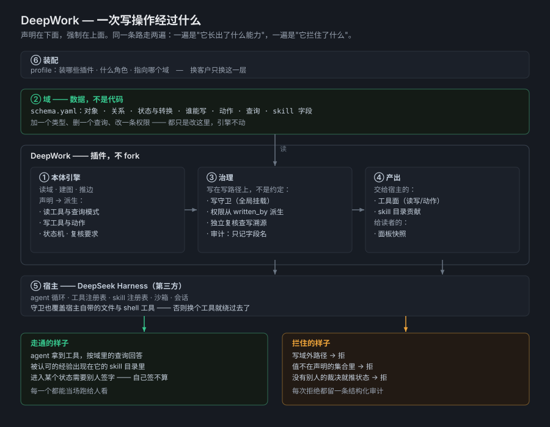

# DeepWork

> An enterprise agent has to know what a project is, who owns it, which customer it belongs
> to, and **what it is allowed to touch**. DeepWork is where an enterprise writes that down —
> and where an agent's tools and permissions are derived from it, and enforced.
>
> It is deliberately not part of an agent. The world it describes belongs to the enterprise, so
> the second agent, the third, and the one after that read the same one.

DeepWork is a platform built on [DeepSeek Harness](https://github.com/deepseek-ai/deepseek-harness)
(DSH). DSH ships a complete agent harness; DeepWork adds the one thing it does not ship — the
enterprise's own world, and the rules for acting in it. A plugin, not a fork, and a new domain
costs YAML rather than code.

## The whole project, as one line

Every part of this repository is one step of the same journey: a **world is declared**, an
**agent is equipped** from it, and what that agent does is **governed** on the way out.

```
   the enterprise's world                       what the agent gets
   ──────────────────────                       ────────────────────
①  declared    objects, relations, states,  →   a domain is data: `schema.yaml` and the
               who may write what                instances beside it

②  derived     read tools, the write tool,  →   a capability is declared, not coded —
               declared actions and queries      nothing in TypeScript to add or remove

③  authorised  `written_by` per type,       →   the host's own file and shell tools are
               roles per deployment              covered too; no roles means read-only

④  gated       states, the moves between    →   a move needing a second pair of eyes is
               them, and what each needs         refused without a verdict from somebody
                                                 other than the person making the move

⑤  recorded    the audit trail and write    →   every attempt, refusals included; field
               provenance                        names and never field values

⑥  checked     `npm run validate`           →   a declaration that did not take effect is
                                                 a failure, not a silence
```

Read it top to bottom and this repository is one thing. Read the sections below out of order
and it is a list of mechanisms.

The same line as a picture — what a write passes through, and what comes out either side:



## Who this is for

Anyone putting an agent into a real business system. A forward-deployed engineer standing up
the first use case; a platform team that has to answer "what is this agent allowed to touch,
and who approved it"; the team that inherits it six months later.

## If you only look at one thing

`packages/ontology/examples/engagement` is the whole line at small scale: four stages, three of
them gated on a signature scoped to that stage, one declared action, one relation.

```sh
corepack pnpm install            # once, right after cloning — nothing else is needed
npm run validate                  # is it sound? exit 0 or a list of what did not take effect
node packages/ontology/scripts/show-derivation.ts packages/ontology/examples/engagement
```

The second command prints what came out of the declaration — and note what it prints with no
roles configured: three read tools, no write tool, and no actions derived, because an
unconfigured deployment is a read-only one.

Then `packages/ontology/src/examples.test.ts` runs it for real — a stage cannot be entered
without its signature, a signature for one stage does not open the next, and the role that
makes a move cannot sign for it. Those three sentences are the project, and they are a test
rather than a paragraph.

## The gap this fills

DSH ships a complete agent harness — loop, tools, skills, workflows, plan mode, approval,
subagents, sandboxing. What it does not ship is any notion of *the enterprise world* the
agent is working in. A general agent sees `document_001`, `project_782`, `user_23891`. An
enterprise agent needs to know what a project is, who owns it, which customer it belongs
to, and what it is allowed to touch.

That gap is semantic, not mechanical. This project fills it, and nothing else.

There is a third layer between the model and the harness, and this project is it. A model
reasons; a harness executes; neither knows what the enterprise *is*. That layer has to be
**declared**, and that word is doing the work. A context assembled per request out of whatever a
search surfaced is a guess about relevance — a good guess, and still a guess, and different on
Tuesday. A context declared as objects, relations and rules is a fact the enterprise can be asked
about, diffed, and held to, and the same question asked twice answers the same way.

It also has to distinguish what somebody vouched for from what merely got recorded. A layer that
cannot tell a rule a person signed off on from a note an agent wrote yesterday has made its own
trustworthiness a second thing nobody can check — so that distinction is a lifecycle here, and
only the vouched-for half ever reaches an agent.

```
DSH provides                    DeepWork adds
──────────────                  ──────────────
agent loop                      ontology    entities, relations, declared queries
tools                           governance  written_by, file_location, required_fields
skills                          injection   the vouched-for rules a situation obliges
                                audit       every write attempt, refusals included
workflow
plan mode
human review
sandbox
```

## The claim

**A domain author writes YAML. The agent gets tools. Nobody writes TypeScript.**

```yaml
functions:
  open_issues_of:
    description: Issues still open against a given project.
    use: traverse
    relation: reported_on
    direction: incoming
    by: project_id
    where: { status: open }
```

Those eight lines produce a callable mode, with its argument typed from the field
declaration it names. Adding a type makes it queryable. Deleting a function removes the
mode. Neither touches the plugin.

Governance works the same way. `written_by` on a type is the policy; there is no per-tool
check anyone has to remember to add. With no roles configured the write tool is not
registered at all, so an unconfigured deployment is a read-only one rather than a
permissive one.

## Ten seconds, no runtime

The engine depends on nothing from the host, so a domain can be watched deriving its tools
without installing one — no runtime, no API key, no agent. The same domain, declared twice:
with nobody authorised to write, then with one role declared.


The picture is generated from the command below, not drawn, so it cannot drift from the
output (`node packages/ontology/scripts/render-demo-svg.ts`).

```sh
corepack pnpm install            # once, right after cloning
node packages/ontology/scripts/show-derivation.ts packages/ontology/examples/project-delivery
```

```
domain   packages/ontology/examples/project-delivery
         5 object types, 16 instances, 6 relations (22 edges)

tools    4 read, 0 write
         ontology_get
         ontology_find
         ontology_links
         ontology_query
         no write tool — with no roles configured, the deployment is read-only

objects
         Customer     key=customer_id    instances=2   may write: delivery-lead
         Project      key=project_id     instances=3   may write: delivery-lead, system
         Person       key=employee_id    instances=3   may write: delivery-lead
         Issue        key=issue_id       instances=5   may write: delivery-lead, engineer
         Document     key=document_id    instances=3   may write: delivery-lead
```

Say who may write and the write tool appears, along with a tool per declared action. Declare a
lifecycle and the states arrive with the rules that govern them — who may move something, and
which moves need somebody else's verdict:

```sh
node packages/ontology/scripts/show-derivation.ts packages/ontology/tests/fixtures/review-delivery   --roles '[{"prefix":"session-","role":"engineer"}]'
```

```
tools    3 read, 1 write
         ontology_get
         ontology_find
         ontology_links
         ontology_write   (registered because roles are configured)

objects
         Deliverable  key=deliverable_id instances=1   may write: engineer
                      states: draft → signed_off
                      sign_off: draft → signed_off   by: engineer   requires an independent verdict
         Signoff      key=signoff_id     instances=1   may write: reviewer
```

That second run is a governance model in fifteen lines, and not one of them was written by
hand: it is the domain, read back. The enforcement behind those lines is described under
[Governance](#governance) and checked by 168 tests.

## What it looks like when an agent uses it

A real session, with the query modes the agent chose and the answer it reached — including two
details that only a declared world can produce: it refused to invent a project name the schema
does not declare, and it drew a conclusion that needed the graph rather than a lookup.

[docs/agent-session.md](docs/agent-session.md) — and the [same domain asked in Chinese](docs/agent-session-zh.md), where the agent reached the same four declared queries

## Status

Working and demonstrated, not finished.

| Milestone | State |
|---|---|
| Plugin route — a third-party package installs and mounts in DSH | ✅ verified end to end |
| Ontology engine — schema parsing, instance loading, relation derivation | ✅ covered by the suite |
| Derived tool surface — reads | ✅ verified with real agent turns |
| Derived governance — writes, permissions, audit | ✅ verified with a real refusal and a real write |
| Write guard — every tool call, not only ours | ✅ mounted globally; a real refusal and a real shell-redirect refusal observed, both audited |
| Declared lifecycle — states, transitions, who may move them | ✅ enforced on the write path; a real refusal and a real promotion observed, both audited |
| Reads default to the vouched-for state | ✅ and say how many they left out, rather than narrowing quietly |
| Declared counters — who may record usage | ✅ granted apart from `written_by`; verified live by a role that may count and may not author |
| Declared actions — a named way to write, not only the generic tool | ✅ one tool per declaration; verified live, preconditions and role narrowing included |
| Declared review — a move that needs an independent verdict | ✅ enforced against provenance the platform recorded; a promotion went through on another session's verdict and was refused without one |
| Declared value sets — a field's `values` as a closed set, not a hint | ✅ a value outside it is refused with `value-not-declared`, through the generic write tool and through a declared action |
| Declared-domain validation — an exit code a pipeline can read | ✅ a sound domain passes, a malformed one fails naming the declaration that was dropped |
| Example domain — the demo scenario | ✅ end to end |
| Workspace UI | ✅ a page inside DSH's own interface, not a second server |
| Published to npm | prepared, not published |

168 tests in total.

The engine and every derivation are testable without a runtime, an API key, or an agent,
because the package depends on nothing from DSH. That is why the test suite runs in under
a second.

## What is deliberately not here

Scope is a design decision, so what this project refuses is worth naming as plainly as what it
does. Each of these was considered and declined, not overlooked.

- **Not a second UI.** The panel is a page inside DSH's own interface. An earlier standalone
  workspace was retired the moment that turned out to be unnecessary — it had become a second
  place to stand, reimplementing one that was already there.
- **Not a memory layer, a retriever, or an agent framework.** The host already has session
  history, workspace instructions, skills and subagents. The mechanism it lacks is knowing what
  the enterprise's objects *are*; a second one of anything above would be a second source of
  truth.
- **Not a fork**, and not a wrapper around one: a plugin, tracking upstream releases.
- **Not credential storage.** A domain may point at a secret; the value stays in the host's
  credential seam and never enters the domain, the audit trail, or anything a model reads.
- **Not the working record.** The decision log, the verified facts and the environment pitfalls
  are kept locally and are not published. It is written as notes, in the language of the work,
  which means it keeps collecting names and paths that do not belong in public — sanitising it
  was a losing game, and the file that said so was the file that broke the rule. What a reader
  loses is the sight of a working process; what it stops is the leak that process produces.

And the honest half — what a reader will find missing:

| Missing | Where it stands |
|---|---|
| One artefact showing a task start to finish — a recording, not a description | sessions are recorded as documents and refusals as audit entries, but there is no single thing a stranger can watch |
| `deepwork init` — a domain to copy and rename | the three examples are the starter material |
| Validation on several real domains | one production domain has been through it — 17 object types, 269 instances, 214 relations — and that run is what put the two-level diagnostics in. One is not several |
| External system access | declared as a pointer, nothing more |

## Quick start

```sh
git clone <this repo> && cd deepwork
corepack pnpm install
mkdir -p dist
cd packages/ontology && corepack pnpm run build && npm pack --pack-destination ../../dist && cd ../..

# point a DSH profile at the example domain
export DSH_HOME="$(pwd)/.dsh-home"
./node_modules/.bin/dsh --profile headless --dump-config > /dev/null
./node_modules/.bin/dsh plugin --profile headless add ./dist/deepwork-ontology-0.1.0.tgz

export DEEPWORK_ONTOLOGY_ROOT="$(pwd)/packages/ontology/examples/project-delivery"
./node_modules/.bin/dsh headless "Analyse the risk on project P-2026-001 and give me a management briefing."
```

To allow writes, say who may write. The role map is the gate:

```sh
export DEEPWORK_ONTOLOGY_ROLES='[{"prefix":"session-","role":"delivery-lead"}]'
```

A rule whose prefix is `*` matches every caller, and is how a deployment states the role it
acts as instead of inferring one from ids it does not generate. Prefer it unless one process
hosts several kinds of agent: an id-shaped rule is an assumption about the host's naming, and
when the host renames its agents the rule stops matching and every write is refused — which
reads as a permissions problem rather than as the stale assumption it is. `*` is one character,
so any real prefix still beats it and a mixed deployment can name its agents individually.

## Seeing what a domain derives

The panel lives inside DSH's own interface rather than beside it: one process, one origin,
no second server to run and no RPC layer. Install the plugin into a profile, open DSH's web
UI, and the **Ontology** row in the sidebar shows what the engine derived from the domain —
the tool definitions with the JSON Schema of every argument, the object types with who may
write them, and the relations with the field each one reads.

Put a role map in the `roles` box and the write tool appears in the listing; leave it empty
and the page explains why it does not. That is the governance model answering a question out
loud, from the running system, instead of from a document.

Only domains named in `DEEPWORK_DOMAINS` (or the bundled example) are readable, because a
path arriving from a browser is an arbitrary-read request.

## Checking a domain

The panel answers "what did this domain derive". `npm run validate` answers "did any of it
fail to happen", which is the question that matters before a domain is deployed:

```sh
npm run validate
npm run validate -- packages/ontology/tests/fixtures/broken
```

Exit 0 means every declaration took effect. Exit 1 lists what did not, each with the name of
the thing that was dropped — an action pointing at an undeclared type, a field the type does
not have, a function whose mode is unavailable. Pass `--role prefix=role` to make the write and
action halves reachable; without it the command says so rather than reporting a shorter list
as a clean one, because with no roles nothing derives there and "declared equals derived" has
nothing to compare.

A schema file that cannot be read at all is the one failure that stops before there is a
domain to check, so it is reported as a failing domain rather than as a diagnostic.

### Problems and notes

A report has two levels, and the line between them is *who has to act*.

**Problems** need somebody to act, and they fail the run: a declaration that cannot take effect
(an action pointing at a type that does not exist, a field the type does not have, a transition
naming a state that was never declared), or an instance file that could not be read. **Notes**
are facts about the data that need nobody to act, and never fail: a declared directory with
nothing in it yet, a relation no instance has wired, an instance whose identity fell back to its
filename. Notes are still counted and printed — "nothing to fix" must not read as "nothing to
see", since an empty query result is exactly what those notes explain.

The line was drawn by real data, not by taste. A production domain — 17 object types, 269
instances, 214 relations — loaded and answered correctly and produced nine unwired relations and
three empty directories. Judged as failures, that report had nothing green in it, and a check
that is always red is a check nobody reads. Split, the same run says what it should: four things
the data has not grown into yet, and no defects at all.

Because the first version of that command did not split them, and because the fixture domains it
was built against were small, new, and written by the same hand, nothing caught it until a real
domain was put through. `packages/ontology/tests/fixtures/ahead-of-its-data` now pins the policy.

## What is in here

| Path | What it is |
|---|---|
| `packages/ontology` | the plugin: engine, tool derivation, governance |
| `packages/ontology/examples/project-delivery` | a complete synthetic domain to point at |
| `packages/ontology/examples/lessons` | the experience loop as a domain: a lesson arrives as a `candidate`, reads return only what somebody else upheld, and counting applications is a grant apart from writing one |
| `packages/ontology/examples/engagement` | a staged delivery: four phases, and the customer's signature scoped to the stage it opens, so the road opens one gate at a time |
| `packages/test-runner` | a capability: run a project's tests and read what the run said (see its README) |
| `packages/probe` | the smallest possible plugin, kept as the smoke test for the plugin route |
| `tools/fde` | the FDE toolkit: qualify a use case before anything gets built (Python, runs standalone) |
| `docs` | two recorded agent sessions, the derivation picture, and the architecture picture |

## Governance — steps ③ to ⑥, in detail

Each mechanism below is one step of the line at the top, declared in the domain and enforced
in code. Read in that order they are a conveyor: what a write must satisfy, what it leaves
behind, and what a reader can check afterwards. None of them is a convention a tool author has
to remember, which is the whole difference between governance and a note asking people to be
careful.

**The write guard covers every tool call, not only ours.** A check inside our own tools
leaves the host's filesystem tool and its shell unguarded, and those are the ones a model
reaches for. The guard is mounted globally, derives the directories a role may write from
`written_by`, and reads shell commands for redirection (`>`, `>>`, `tee`) as well as
inspecting write tools. With no roles configured, every write is refused — an unconfigured
deployment is a read-only one rather than a permissive one. Its own limits are written down
in the code (`UNCOVERED_BY_GUARD`) rather than left to be discovered.

**A tool says what it touches, and the domain says who may call it.** The guard used to
recognise tools by name: two constants, one for writers and one for shells. That governs
exactly the tools its author knew about, so a capability added by another package was invisible
to it — and invisibly, which is the worst way to be ungoverned. A first capability that runs a
project's tests walked past a boundary that refuses the same write made through `write`: three
names refused for touching `.junit.xml`, and the fourth doing the same thing let through. So a
tool now declares its own arguments — which hold a path it writes, a path it runs what is in, or
a command line — and the guard reads the declaration instead of a name. The host's own tools are
described the same way, by a built-in table, so there is one mechanism rather than two.

The other half has to come from the deployment, and it does: `tool_grants` names the roles that
may call a tool. Only the domain knows who is allowed. It matters most for `executes`, because
running code has no directory in the domain to be judged against — the target of a test run is a
project, not an object — so the grant is the whole of its authority, and a tool that runs code
with no grant is **refused** rather than licensed. "Nobody said who may call this" is the worse
answer to give an execution tool.

Verified live, both directions on one call: as a role the domain did not grant, the call was
refused with a message naming the role and the roles that may; as the granted role it ran and
reported the project's own junit line. Both outcomes are in the audit trail, the refusal included.
What this cannot close from here is stated rather than implied: a tool that declares nothing is not
governed, and only a declaration can put it under the guard.

**Every attempt is audited, refusals included.** A log that only records what succeeded
cannot answer the question asked after an incident, which is what was *tried*. Entries carry
field *names* and never field values: an audit trail that copies domain content into a second
file doubles the surface that content can leak from.

**A declared set of choices is enforced, not advertised.** A field declaring `values` reaches
the model as a JSON Schema `enum`, and that is advice: a model that supplied something else was
written through, which left the declaration descriptive and the value set advisory. The write
path now refuses a value outside the declared set, naming the field and the choices it accepts.
Only the fields a call supplies are judged, so a violation already on disk does not hold every
later correction hostage to it — reporting that belongs where it can be seen without blocking a
fix. Verified live: `severity: "critical"` was refused with `value-not-declared` through the
generic write tool and through a declared action, and the entry in the trail names the field
without echoing the rejected value.

**A lifecycle is a declaration, not a code path.** States, the initial state, the moves
between them and the roles allowed to make each move are read from the schema and enforced on
the same write path as any other write — so the ACL and the audit already cover promotions,
with no second path to forget about. Reads honour a declared default state, and report how
many entities they left out rather than narrowing quietly.

**An action is a declaration, and it is not a second write path.** The ontology model is
objects, links, actions and functions; `action_types` used to be parsed and counted while
nothing derived from it, so a domain could declare an action, see it in the summary, and get
nothing when calling it. Actions now derive a tool each — with intent the generic write tool
does not carry: `create` refuses an identity that already exists, `update` refuses one that does
not, and `by` narrows the type's grant rather than replacing it. Every one of them calls the same
function the generic write tool calls, which is why the permissions, lifecycle, review, counters,
audit and provenance above apply to an action without being restated. Verified live: a create
that collided was refused with `already-exists`, a role outside the action's grant was refused
with `role-not-permitted`, and both appear in the trail under the action's own name.

**Independent review is checked against provenance, not against a claim.** A move can require
a passing verdict, and the verdict must have been produced by someone other than the caller.
That question is answered from a sidecar the platform writes itself, never from a field the
caller filled in — a verdict that names its own producer is a form, not a control. A verdict
whose producer cannot be established is refused, because "we cannot tell who reviewed this"
is not "somebody did".

**A requirement can be scoped to one gate, so a sequence stays a sequence.** Unscoped, "a
passing verdict about this subject exists" is the whole rule — which is right for a single
decision and wrong for a staged workflow, where the first signature would open every stage after
it, each of them being a passing verdict about the same engagement. A requirement may therefore
name a second field and value the verdict has to carry (`scope: { field: gate, value: build }`),
so one signature opens one gate. It is declared per requirement rather than solved by giving each
gate its own verdict type, because that would mean granting a signer once per gate.

## Vouched-for experience, as skills

A skill is know-how — how to do a thing. The ontology is know-*what*. The two meet at one
declaration: a type says which of its fields carry an experience, and the set exposed as skills
is the set a read returns, drawn from the lifecycle's `default_state` — the state the domain
called vouched-for.

```yaml
  Lesson:
    lifecycle:
      field: status
      initial: candidate
      default_state: verified        # what a read returns
      states: [candidate, verified, rejected]
    skill:                           # and what an agent may load
      description: rule
      when_to_use: applies_to
      body: rule
```

One declaration answers both questions, so a candidate is in neither answer. That is the part a
skill catalog cannot do on its own: a catalog offers everything and lets the model choose; this
offers what somebody upheld, and the agent sees it in the catalog it already uses.

Verified end to end: with that domain loaded, the agent's own skill listing contains
`lesson-les-001` and not the candidate beside it. Seven tests run the mapping, including the two
ways it can fail — a skill naming a field the type does not declare, and a vouched-for object
whose named field is empty.

### The circuit, both ways

Experience comes *in* and goes *out* through the same two declarations, and one action names each
direction:

```yaml
action_types:
  record_lesson:  { use: create, target: Lesson }   # in: experience arrives as a candidate
  uphold_lesson:  { use: update, target: Lesson }   # the move, once somebody else vouches
```

An agent that learns something calls `record_lesson` and it lands as a `candidate` — recorded, and
not loadable. A second party writes a verdict; a third role makes the move; the lesson becomes
`verified` and appears in the catalog the agent reads. The test walks that whole circuit over a
throwaway copy, including the move that must not exist: a lesson cannot arrive already vouched
for. Asked as a contributor that is refused by the role, and asked as a curator it is refused for
want of a verdict — the write path settles the mover before it settles what the move needs.

Two limits, stated rather than implied. **Routing stays with the model** — this decides what is in
the catalog, not whether the agent loads it. And **the catalog is built at load**, so experience
promoted during the same process appears after a restart; promotion is rare enough that
re-registering on every write would cost more than it buys.

### The same experience, written into the prompt

A catalog is a list of names the model has to remember to consult, and for know-how that is
enough — it reaches for a procedure when it wants one. A **rule** is not know-how. One the model
may load is one it may miss, and "money is compared as integers, never as floats" is not advice.
So the vouched-for set has a second surface, and it is the same set: the `skill` block also says
which field carries the routing tags (`when_to_use`) and which carries the heading a listing
groups by (`group_by`), and the plugin registers one prompt section built from them.

Which of the rules land in that section is the deployment's situation, and a situation has two
halves — because a rule is about *a thing* and *when*:

```bash
DEEPWORK_ONTOLOGY_ACTIVE="CASE-1042"    # what you are working on — the stage follows from it
DEEPWORK_ONTOLOGY_SITUATION="role:analyst"   # who you are; "at what" is no longer typed by hand
```

The first half is a declaration too, not a convention. The domain names the type that carries
"what am I making" — `situation: { product_type: Deliverable }` — and a rule's constraints are its
declared relations into that type, whatever the relation is called. So "which rules govern the case
I am writing" is a graph query in both directions rather than a string comparison, and renaming
`constrains` to `governs` costs the engine nothing. An object id resolves through the product the
domain says that kind of thing is (`produced_as`); a product id names it directly, which is what
covers the products with no object behind them — a pytest script never enters the ontology, since
the domain stores a pointer rather than a copy.

Naming the thing rather than the phase is the point. A phase is a vocabulary somebody has to
remember and can get wrong in silence; `CASE-1042` is something they can see and copy, and the
tags are computed from it. That is the whole of what was meant by the ontology knowing where it is.

That extends to the stage itself. `situation: { state_tags: … }` says which state of which type
stands for which tag, so the object answers "which stage am I at" rather than the person answering
it — the half that used to be the easiest to get wrong in silence is now a fact read off the thing
being worked on. The section prints what it read (`Situation computed from: Engagement E-7 is build, which
this domain maps to stage:delivery`), because a computed situation has no other way to be
checked: a tag somebody typed is visible in the prompt, and a tag derived from a state has to
bring the state with it or a wrong answer is indistinguishable from a right one.

A lifecycle declared for this purpose deliberately omits `default_state`. That field means "a read
returns only this state", which is what makes a candidate invisible until somebody vouches for it —
right for a rule, and wrong for a deliverable, where it would hide every case that is not yet
approved. So the states are tracked and the moves between them are enforced, and reads are
unfiltered; the two uses of a lifecycle are one declaration but not one meaning.

What this answers is not "what does the enterprise know" but **what does this moment require**,
and the answer is computed from what the session is working on rather than chosen by the model. A
search box answers "what might be relevant"; this answers "what applies here", and it is the same
answer every time the situation is the same. The gap between those two questions is where a rule
gets missed.

More context is not the goal, either, and it is not free. Every rule that reaches the prompt
competes for attention with the task itself; a rule that is merely *available* competes for
nothing. So the mechanism is built to keep that distinction explicit rather than to maximise what
is loaded — injected is what a person signed off on and the situation demands, and everything else
stays one lookup away, named and countable rather than gone.

A rule applies when it clears two gates, each of which opens on what its side did not state: it
constrains one of the products being worked on **or** constrains nothing in particular — "money is
compared as integers" is not about any one deliverable and must survive naming one — and it shares
any one tag with the situation, or declares none. Unstated means every vouched-for rule, because a
requirement is the wrong thing to be selective about by accident. A tag that matches nothing, or an
id nothing answers to, is reported rather than quietly yielding an empty section: from inside the
rule set, a typo and a genuine silence look identical, and only one of them is a mistake.

It also carries a ceiling, because a domain grows and a prompt does not. `DEEPWORK_ONTOLOGY_BUDGET`
caps the listed rules in characters — 32000 by default, about 230 rules against the 71 this was
built for, so it does not bind today. When it does bind, the ranking is what it spends: most rules
carry a role tag, so a two-tag situation matches a large part of a domain and "matches" stops
meaning anything on its own. The rank is how many dimensions the situation actually pins down — the
product counts as one, each tag dimension as another — so a rule written for this product, role and
phase outranks one that only names the role, and what is held back is the most general advice
rather than whichever rule was listed last. That is also why the ceiling measures the list and not
the framing around it: counting the framing would put the note that reports the omissions in
competition with the rules it describes.

Three decisions worth naming, since each is a place the obvious thing is wrong:

- **The section is built at load**, from the graph already in hand rather than re-read per turn.
  What is injected therefore cannot drift from what the read tools return, and a domain file that
  becomes unreadable mid-session cannot fail prompt assembly. The cost is the catalog's cost:
  promotion waits for a restart.
- **`interpolate: false`**, because the host's `{{variable}}` references are strict and this text
  comes from domain data. A rule that happened to contain a brace pair would otherwise take every
  turn down with it. Not hypothetical: the check that pins it is a rule whose body contains
  `{{undeclared}}`, injected and answered back verbatim.
- **It registers even when the situation selects nothing.** Registering only when rules were
  selected meant a mistyped tag produced no section at all, so the one case where the deployment
  needs telling was the one case where it was told nothing. A live run found that, not the tests.

Verified end to end: the same question under two situations returns two different sets of
must-follow rules, and a candidate is in neither. Naming an object id pulls the right product out of
the ontology and the right subset of rules with it — and a rule that does not govern that product
leaves the must-see set while staying in the skill catalog, which is the difference between "not
required" and "withheld". With the ceiling set low enough to bind, the agent reports the count it
was given, quotes the sentence saying what was held back, and answers yes when asked whether one of
the held-back rules is still in its catalog.

## Design notes

Four tools, and only one grows with the domain. `ontology_get`, `ontology_find` and
`ontology_links` are parameterized *by* type rather than duplicated *per* type, so forty
entities still expose three tools. `type` and `relation` are closed enums built from the
schema, so the model cannot name something that does not exist. `ontology_query`'s `mode`
enum is the only part that scales, and an enum value costs far less than a tool whose
description crowds out the task.

Two rules that look like details and are not:

- **A relation is a field, but a field is not a relation.** An edge exists when an
  instance carries the field its relation names *and* the instance's type is that
  relation's declared source. Without the second half, a primary-key field that happens
  to share a relation's name produces a self-loop, which then turns up in an answer.
- **A capped result must say it was capped.** `total`, `returned` and `truncated` are
  required fields of every tool's output. A result that hides its own truncation invites
  the model to read a partial answer as the whole one.

Full detail, including the declarations and the governance model, is in
[`packages/ontology/README.md`](packages/ontology/README.md).

## Applications

The platform is meant to be used, so it ships with applications built on it rather than beside it.

**`tools/fde` — qualifying a use case before building it.** An ontology is cheap to extend and expensive to get wrong: the usual failure is not a bad agent, it is a use case that was never worth doing, discovered three weeks in. This tool scores a candidate use case across five weighted dimensions, applies hard floors, and returns *go*, *validate first* or *decline* — naming the evidence that is missing rather than averaging it away.

A dimension with no written evidence counts as **unknown**, and any unknown caps the decision. That is the whole point: unknown is not the same as zero, and a silent downgrade is how a pilot becomes a promise nobody can keep.

```sh
python tools/fde/usecase/score.py tools/fde/usecase/examples/sample-service.yaml
```

It is Python and runs standalone — no runtime, no API key — so it works with or without DSH present. Everything else it needs is in [`tools/fde/README.md`](tools/fde/README.md).

## Positioning

DeepWork is **a plugin, not a fork**. It extends DSH through its published extension
points and follows upstream releases instead of diverging from them. DSH currently does
not accept external pull requests; the ecosystem route it names is a plugin plus the
[`dsh-plugin`](https://github.com/topics/dsh-plugin) topic, which is the route taken here.

Naming follows the [DeepSeek Harness brand guidelines](https://github.com/deepseek-ai/deepseek-harness/blob/master/BRAND_GUIDELINES.md):
no use of the "DeepSeek Harness" trademark in the project name, relationship described as
"built on DSH".

## License

MIT. See [LICENSE](LICENSE).
