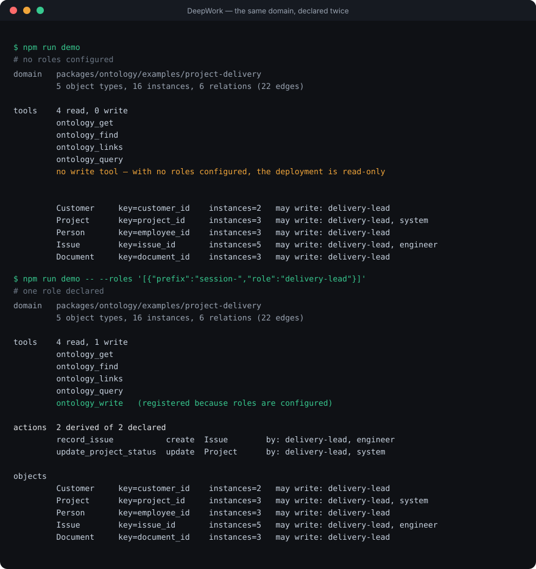

# DeepWork

> An enterprise ontology and governance layer for [DeepSeek Harness](https://github.com/deepseek-ai/deepseek-harness) (DSH).
>
> **Declare an enterprise world once, and derive the agent's tools and permissions from it.**

## The gap this fills

DSH ships a complete agent harness — loop, tools, skills, workflows, plan mode, approval,
subagents, sandboxing. What it does not ship is any notion of *the enterprise world* the
agent is working in. A general agent sees `document_001`, `project_782`, `user_23891`. An
enterprise agent needs to know what a project is, who owns it, which customer it belongs
to, and what it is allowed to touch.

That gap is semantic, not mechanical. This project fills it, and nothing else.

```
DSH provides                    DeepWork adds
──────────────                  ──────────────
agent loop                      ontology    entities, relations, declared queries
tools                           governance  written_by, file_location, required_fields
skills                          audit       every write attempt, refusals included
workflow
plan mode
human review
sandbox
```

## The claim

**A domain author writes YAML. The agent gets tools. Nobody writes TypeScript.**

```yaml
functions:
  open_issues_of:
    description: Issues still open against a given project.
    use: traverse
    relation: reported_on
    direction: incoming
    by: project_id
    where: { status: open }
```

Those eight lines produce a callable mode, with its argument typed from the field
declaration it names. Adding a type makes it queryable. Deleting a function removes the
mode. Neither touches the plugin.

Governance works the same way. `written_by` on a type is the policy; there is no per-tool
check anyone has to remember to add. With no roles configured the write tool is not
registered at all, so an unconfigured deployment is a read-only one rather than a
permissive one.

## Ten seconds, no runtime

The engine depends on nothing from the host, so a domain can be watched deriving its tools
without installing one — no runtime, no API key, no agent. The same domain, declared twice:
with nobody authorised to write, then with one role declared.



The picture is generated from the command below, not drawn, so it cannot drift from the
output (`node packages/ontology/scripts/render-demo-svg.ts`).

```sh
node packages/ontology/scripts/show-derivation.ts packages/ontology/examples/project-delivery
```

```
domain   packages/ontology/examples/project-delivery
         5 object types, 16 instances, 6 relations (22 edges)

tools    4 read, 0 write
         ontology_get
         ontology_find
         ontology_links
         ontology_query
         no write tool — with no roles configured, the deployment is read-only

objects
         Customer     key=customer_id    instances=2   may write: delivery-lead
         Project      key=project_id     instances=3   may write: delivery-lead, system
         Person       key=employee_id    instances=3   may write: delivery-lead
         Issue        key=issue_id       instances=5   may write: delivery-lead, engineer
         Document     key=document_id    instances=3   may write: delivery-lead
```

Say who may write and the write tool appears, along with a tool per declared action. Declare a
lifecycle and the states arrive with the rules that govern them — who may move something, and
which moves need somebody else's verdict:

```sh
node packages/ontology/scripts/show-derivation.ts packages/ontology/tests/fixtures/review-delivery   --roles '[{"prefix":"session-","role":"engineer"}]'
```

```
tools    3 read, 1 write
         ontology_get
         ontology_find
         ontology_links
         ontology_write   (registered because roles are configured)

objects
         Deliverable  key=deliverable_id instances=1   may write: engineer
                      states: draft → signed_off
                      sign_off: draft → signed_off   by: engineer   requires an independent verdict
         Signoff      key=signoff_id     instances=1   may write: reviewer
```

That second run is a governance model in fifteen lines, and not one of them was written by
hand: it is the domain, read back. The enforcement behind those lines is described under
[Governance](#governance) and checked by 157 tests.

## What it looks like when an agent uses it

A real session, with the query modes the agent chose and the answer it reached — including two
details that only a declared world can produce: it refused to invent a project name the schema
does not declare, and it drew a conclusion that needed the graph rather than a lookup.

[docs/agent-session.md](docs/agent-session.md) — and the [same domain asked in Chinese](docs/agent-session-zh.md), where the agent reached the same four declared queries

## Status

Working and demonstrated, not finished.

| Milestone | State |
|---|---|
| Plugin route — a third-party package installs and mounts in DSH | ✅ verified end to end |
| Ontology engine — schema parsing, instance loading, relation derivation | ✅ covered by the suite |
| Derived tool surface — reads | ✅ verified with real agent turns |
| Derived governance — writes, permissions, audit | ✅ verified with a real refusal and a real write |
| Write guard — every tool call, not only ours | ✅ mounted globally; a real refusal and a real shell-redirect refusal observed, both audited |
| Declared lifecycle — states, transitions, who may move them | ✅ enforced on the write path; a real refusal and a real promotion observed, both audited |
| Reads default to the vouched-for state | ✅ and say how many they left out, rather than narrowing quietly |
| Declared counters — who may record usage | ✅ granted apart from `written_by`; verified live by a role that may count and may not author |
| Declared actions — a named way to write, not only the generic tool | ✅ one tool per declaration; verified live, preconditions and role narrowing included |
| Declared review — a move that needs an independent verdict | ✅ enforced against provenance the platform recorded; a promotion went through on another session's verdict and was refused without one |
| Declared value sets — a field's `values` as a closed set, not a hint | ✅ a value outside it is refused with `value-not-declared`, through the generic write tool and through a declared action |
| Declared-domain validation — an exit code a pipeline can read | ✅ a sound domain passes, a malformed one fails naming the declaration that was dropped |
| Example domain — the demo scenario | ✅ end to end |
| Workspace UI | ✅ a page inside DSH's own interface, not a second server |
| Published to npm | prepared, not published |

157 tests in total.

The engine and every derivation are testable without a runtime, an API key, or an agent,
because the package depends on nothing from DSH. That is why the test suite runs in under
a second.

## Quick start

```sh
git clone <this repo> && cd deepwork
corepack pnpm install
mkdir -p dist
cd packages/ontology && corepack pnpm run build && npm pack --pack-destination ../../dist && cd ../..

# point a DSH profile at the example domain
export DSH_HOME="$(pwd)/.dsh-home"
./node_modules/.bin/dsh --profile headless --dump-config > /dev/null
./node_modules/.bin/dsh plugin --profile headless add ./dist/deepwork-ontology-0.1.0.tgz

export DEEPWORK_ONTOLOGY_ROOT="$(pwd)/packages/ontology/examples/project-delivery"
./node_modules/.bin/dsh headless "Analyse the risk on project P-2026-001 and give me a management briefing."
```

To allow writes, say who may write. The role map is the gate:

```sh
export DEEPWORK_ONTOLOGY_ROLES='[{"prefix":"session-","role":"delivery-lead"}]'
```

A rule whose prefix is `*` matches every caller, and is how a deployment states the role it
acts as instead of inferring one from ids it does not generate. Prefer it unless one process
hosts several kinds of agent: an id-shaped rule is an assumption about the host's naming, and
when the host renames its agents the rule stops matching and every write is refused — which
reads as a permissions problem rather than as the stale assumption it is. `*` is one character,
so any real prefix still beats it and a mixed deployment can name its agents individually.

## Seeing what a domain derives

The panel lives inside DSH's own interface rather than beside it: one process, one origin,
no second server to run and no RPC layer. Install the plugin into a profile, open DSH's web
UI, and the **Ontology** row in the sidebar shows what the engine derived from the domain —
the tool definitions with the JSON Schema of every argument, the object types with who may
write them, and the relations with the field each one reads.

Put a role map in the `roles` box and the write tool appears in the listing; leave it empty
and the page explains why it does not. That is the governance model answering a question out
loud, from the running system, instead of from a document.

Only domains named in `DEEPWORK_DOMAINS` (or the bundled example) are readable, because a
path arriving from a browser is an arbitrary-read request.

## Checking a domain

The panel answers "what did this domain derive". `npm run validate` answers "did any of it
fail to happen", which is the question that matters before a domain is deployed:

```sh
npm run validate
npm run validate -- packages/ontology/tests/fixtures/broken
```

Exit 0 means every declaration took effect. Exit 1 lists what did not, each with the name of
the thing that was dropped — an action pointing at an undeclared type, a field the type does
not have, a function whose mode is unavailable. Pass `--role prefix=role` to make the write and
action halves reachable; without it the command says so rather than reporting a shorter list
as a clean one, because with no roles nothing derives there and "declared equals derived" has
nothing to compare.

A schema file that cannot be read at all is the one failure that stops before there is a
domain to check, so it is reported as a failing domain rather than as a diagnostic.

## What is in here

| Path | What it is |
|---|---|
| `packages/ontology` | the plugin: engine, tool derivation, governance |
| `packages/ontology/examples/project-delivery` | a complete synthetic domain to point at |
| `packages/ontology/examples/lessons` | the experience loop as a domain: a lesson arrives as a `candidate`, reads return only what somebody else upheld, and counting applications is a grant apart from writing one |
| `packages/ontology/examples/engagement` | a staged delivery: four phases, and the customer's signature scoped to the stage it opens, so the road opens one gate at a time |
| `packages/probe` | the smallest possible plugin, kept as the smoke test for the plugin route |
| `tools/fde` | the FDE toolkit: qualify a use case before anything gets built (Python, runs standalone) |
| `PROJECT_STATE.md` | the working record: decisions, verified facts, environment pitfalls |

## Governance

Six mechanisms, all of them declared in the domain and enforced in code. None of them is a
convention a tool author has to remember.

**The write guard covers every tool call, not only ours.** A check inside our own tools
leaves the host's filesystem tool and its shell unguarded, and those are the ones a model
reaches for. The guard is mounted globally, derives the directories a role may write from
`written_by`, and reads shell commands for redirection (`>`, `>>`, `tee`) as well as
inspecting write tools. With no roles configured, every write is refused — an unconfigured
deployment is a read-only one rather than a permissive one. Its own limits are written down
in the code (`UNCOVERED_BY_GUARD`) rather than left to be discovered.

**Every attempt is audited, refusals included.** A log that only records what succeeded
cannot answer the question asked after an incident, which is what was *tried*. Entries carry
field *names* and never field values: an audit trail that copies domain content into a second
file doubles the surface that content can leak from.

**A declared set of choices is enforced, not advertised.** A field declaring `values` reaches
the model as a JSON Schema `enum`, and that is advice: a model that supplied something else was
written through, which left the declaration descriptive and the value set advisory. The write
path now refuses a value outside the declared set, naming the field and the choices it accepts.
Only the fields a call supplies are judged, so a violation already on disk does not hold every
later correction hostage to it — reporting that belongs where it can be seen without blocking a
fix. Verified live: `severity: "critical"` was refused with `value-not-declared` through the
generic write tool and through a declared action, and the entry in the trail names the field
without echoing the rejected value.

**A lifecycle is a declaration, not a code path.** States, the initial state, the moves
between them and the roles allowed to make each move are read from the schema and enforced on
the same write path as any other write — so the ACL and the audit already cover promotions,
with no second path to forget about. Reads honour a declared default state, and report how
many entities they left out rather than narrowing quietly.

**An action is a declaration, and it is not a second write path.** The ontology model is
objects, links, actions and functions; `action_types` used to be parsed and counted while
nothing derived from it, so a domain could declare an action, see it in the summary, and get
nothing when calling it. Actions now derive a tool each — with intent the generic write tool
does not carry: `create` refuses an identity that already exists, `update` refuses one that does
not, and `by` narrows the type's grant rather than replacing it. Every one of them calls the same
function the generic write tool calls, which is why the permissions, lifecycle, review, counters,
audit and provenance above apply to an action without being restated. Verified live: a create
that collided was refused with `already-exists`, a role outside the action's grant was refused
with `role-not-permitted`, and both appear in the trail under the action's own name.

**Independent review is checked against provenance, not against a claim.** A move can require
a passing verdict, and the verdict must have been produced by someone other than the caller.
That question is answered from a sidecar the platform writes itself, never from a field the
caller filled in — a verdict that names its own producer is a form, not a control. A verdict
whose producer cannot be established is refused, because "we cannot tell who reviewed this"
is not "somebody did".

**A requirement can be scoped to one gate, so a sequence stays a sequence.** Unscoped, "a
passing verdict about this subject exists" is the whole rule — which is right for a single
decision and wrong for a staged workflow, where the first signature would open every stage after
it, each of them being a passing verdict about the same engagement. A requirement may therefore
name a second field and value the verdict has to carry (`scope: { field: gate, value: build }`),
so one signature opens one gate. It is declared per requirement rather than solved by giving each
gate its own verdict type, because that would mean granting a signer once per gate.

## Design notes

Four tools, and only one grows with the domain. `ontology_get`, `ontology_find` and
`ontology_links` are parameterized *by* type rather than duplicated *per* type, so forty
entities still expose three tools. `type` and `relation` are closed enums built from the
schema, so the model cannot name something that does not exist. `ontology_query`'s `mode`
enum is the only part that scales, and an enum value costs far less than a tool whose
description crowds out the task.

Two rules that look like details and are not:

- **A relation is a field, but a field is not a relation.** An edge exists when an
  instance carries the field its relation names *and* the instance's type is that
  relation's declared source. Without the second half, a primary-key field that happens
  to share a relation's name produces a self-loop, which then turns up in an answer.
- **A capped result must say it was capped.** `total`, `returned` and `truncated` are
  required fields of every tool's output. A result that hides its own truncation invites
  the model to read a partial answer as the whole one.

Full detail, including the declarations and the governance model, is in
[`packages/ontology/README.md`](packages/ontology/README.md).

## Applications

The platform is meant to be used, so it ships with applications built on it rather than beside it.

**`tools/fde` — qualifying a use case before building it.** An ontology is cheap to extend and expensive to get wrong: the usual failure is not a bad agent, it is a use case that was never worth doing, discovered three weeks in. This tool scores a candidate use case across five weighted dimensions, applies hard floors, and returns *go*, *validate first* or *decline* — naming the evidence that is missing rather than averaging it away.

A dimension with no written evidence counts as **unknown**, and any unknown caps the decision. That is the whole point: unknown is not the same as zero, and a silent downgrade is how a pilot becomes a promise nobody can keep.

```sh
python tools/fde/usecase/score.py tools/fde/usecase/examples/sample-service.yaml
```

It is Python and runs standalone — no runtime, no API key — so it works with or without DSH present. Everything else it needs is in [`tools/fde/README.md`](tools/fde/README.md).

## Positioning

DeepWork is **a plugin, not a fork**. It extends DSH through its published extension
points and follows upstream releases instead of diverging from them. DSH currently does
not accept external pull requests; the ecosystem route it names is a plugin plus the
[`dsh-plugin`](https://github.com/topics/dsh-plugin) topic, which is the route taken here.

Naming follows the [DeepSeek Harness brand guidelines](https://github.com/deepseek-ai/deepseek-harness/blob/master/BRAND_GUIDELINES.md):
no use of the "DeepSeek Harness" trademark in the project name, relationship described as
"built on DSH".

## License

MIT. See [LICENSE](LICENSE).
