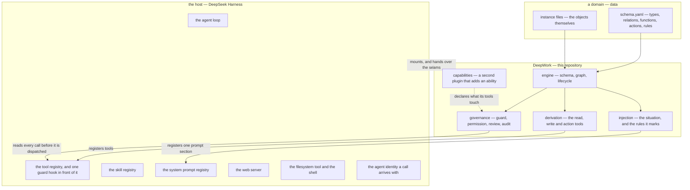
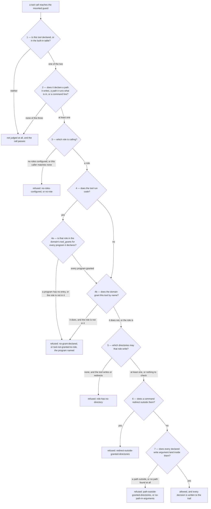
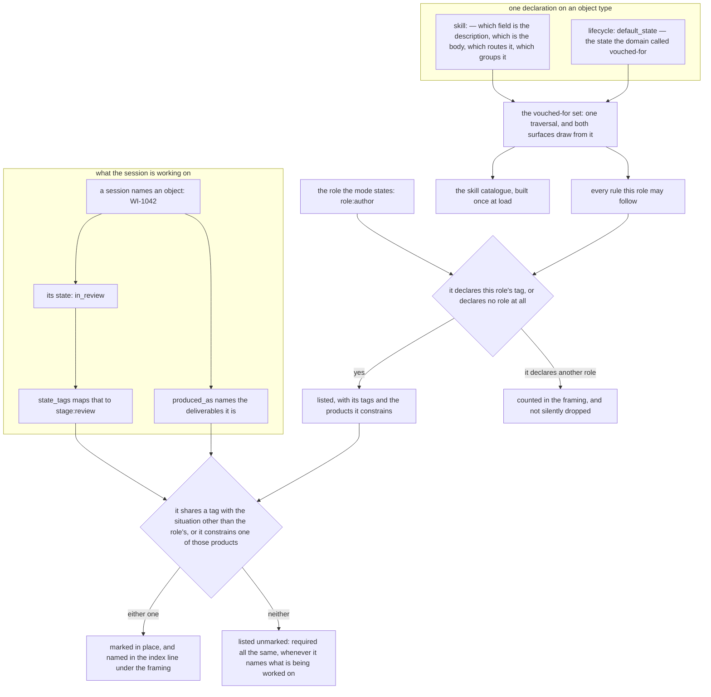
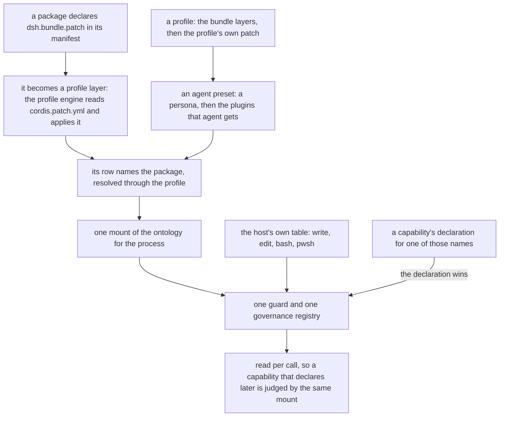

# Architecture

[architecture.zh.md](architecture.zh.md) is the same document in Chinese, for a reader who works in Chinese.

This is what DeepWork is made of, and the route a write takes through it. It is written to be read
beside the code: every claim below is a declaration, a branch or a comment that exists in this
repository, named so that it can be found.

There is no drawn picture of the layers beside this document, and that is a decision with a
history: one was retired rather than maintained. It had been drawn before the prompt-injection
channel existed, before products and deliverables became objects, before governance moved from a
hard-coded list of tool names to declarations, and before the capability layer — so each of those
changes turned it into a picture of a route the code no longer took, and nothing in the repository
could say that it had. The other picture in `docs/`, `derivation.svg`, is different in kind: it is a
real `npm run demo` rendered to an image by `packages/ontology/scripts/render-demo-svg.ts`, so it is
regenerated rather than redrawn. Nothing below depends on either of them.

## The three layers

The host owns the machinery an agent runs on: the loop, the registries, the guard hook, the
filesystem tool and the shell it ships, the web server, the identity a call arrives with. DeepWork
owns the enterprise's world and the rules for acting in it. A domain owns facts only — it is data —
and the boundary between DeepWork and a domain is that a domain author writes YAML while nothing in
the engine is written against a domain.

The host boundary is a build-time claim, and the code states it in one place: `register.ts` says
this package depends on nothing from DSH, and describes the runtime by the smallest structural
interface it actually uses. `OntologyContext` in `index.ts` follows the same rule for the seams —
`inject` takes the names of the services a plugin wants and hands back a scoped context, because
the host's own service types are not imported here. The trade is compile-time checking against
DSH's types, and the code gives the reason it was accepted: `@deepseek-ai/dsh-tools` is not
dependably published, so those types could not be imported anyway, and the boot smoke test is the
real check — it tests more, because it proves the host accepts these schemas at all.

Every seam is optional, and each optional one has an absence that is reported rather than assumed.
A profile with no prompt registry still gets the tools; one with no skill registry still gets the
domain; one with no `provide` gets no governance channel, and the plugin says so at boot. That is
the shape of the whole package: the engine works with no runtime at all, which is why the test
suite runs in under a second and a domain can be watched deriving its tools without an API key.

What makes a domain data is that the engine reads its names out of the file. A short list of
conventions is all of it: `primary_key` (falling back to the first `required_fields` entry, then to
the filename), `file_location` and the directory it names, `produced_as` when a named object has to
resolve to the products it is, and the declarations that carry policy — `written_by`,
`increment_by`, `tool_grants`, `situation`, `skill`. The property is pinned by a test, not asserted:
`engine/graph.test.ts` loads an unrelated domain through the same engine unchanged.

## Interfaces, not objects

A declaration turns into three different kinds of thing, and telling them apart is most of what
makes the rest of this document readable.

**Objects and relations are the world.** They have instances, they have ids, a query returns them,
and a relation is an edge between two of them.

**A function and an action are not objects.** They are how the world is read and how it is changed:
declared in the domain, implemented by the engine. Neither is a type, neither has instances, and
nothing in the graph holds one — a query cannot return an action, and a relation cannot point at a
function. What they have instead is a surface, and the shape of that surface is deliberate:

- a declared function becomes a **mode** of one tool, `ontology_query`. The tool count is fixed and
  the vocabulary is data, so adding a question to a domain adds no tool. A domain that declares no
  function at all still gets the three undeclared read tools — `ontology_get`, `ontology_find`,
  `ontology_links` — which exist precisely so that a world with no queries declared is still
  readable.
- a declared action becomes **a tool of its own**, alongside the generic write tool. Neither of them is
  declared to the governance channel, and that is deliberate: an action's authority is the *write
  path*, which knows the object type, the caller, the current state and whether a second pair of eyes
  is required. So the guard judges **the host's own tools and every capability's tools**, and not
  `ontology_*` at all — nothing declares those to it. `tool_grants` therefore names **programs** and
  **capability tool names**, which are the two things a declaration cannot already judge; an entry
  naming an action does nothing, and a reader who assumed otherwise would be reading a silence this
  project refuses to leave anywhere else.
- a capability's tool is a tool and nothing more. It declares what it touches, and the same guard
  that judges a write judges it.

Three consequences follow from that, and each one is a trade rather than an omission.

**A trail, not a graph, records that something happened.** An action's *products* are objects and
they are in the graph — a run, a verdict, a piece of evidence, an incident moved to a new state. The
*occurrence* of the action is not: it is one line in the audit trail or the provenance file beside
the domain. So "which action changed this, and as whom" is a question for the trail; there is no
edge to walk, and a reader looking for one should stop looking.

**Who may do what is configuration, not an ontology fact.** `written_by` on a type, `tool_grants` in
the domain, and the deployment's role map are three string mappings that the code reads and the
graph does not contain. The graph can say what happened and what state something is in; it cannot
answer "who is allowed to approve this". Putting the policy into the world is possible — an action
becoming an object, a grant becoming a relation — and it would make the ontology larger and every
declaration heavier. This project has not needed it, and this paragraph is the place that trade is
written down rather than rediscovered.

**A skill is an outlet, not a place knowledge is kept.** The knowledge lives in the domain as
ordinary objects: a runbook, a practice somebody vouched for. Two things read them out, and they are
the same declaration read twice — the skill catalogue, which a model may reach for, and the injected
rule block, which it must see. Which one a piece of knowledge gets is decided by how much the agent
may miss it, and nothing is stored in the catalogue that is not an object first.

## One write, end to end

A tool call meets governance in two places, and they answer different questions. The guard is the
door: it decides whether this call may touch this path at all, before any tool runs. The write path
is the desk: it decides whether this content may be written, by this caller, in this state. A
capability's tools stop at the door. This plugin's own write tool passes through the door unjudged
and is settled at the desk — the mounted guard has never heard of `ontology_write`, because nothing
declares it and it is not in the built-in table, so its authority lives inside the tool.

### The door

The guard is mounted once, globally, by `apply` in `index.ts`, and it is mounted even when no roles
are configured — with none, every write is refused, which is the only thing "an unconfigured
deployment is a read-only one" can mean. The identity is mapped explicitly from the host's
`agent.id` to the flat `agentId` the guard reasons over; the comment records why, and it is worth
repeating, because passing the guard straight through compiled and then read no identity at all,
which turned every write into a refusal for the wrong reason.

It decides from two declarations and nothing else: what the tool says it touches, and what the
domain says about who may write where.

The order is the point, and each step is where it is for a stated reason.

Identity comes before anything is decided, because a caller with no role has no writable directory
to reason about, and guessing one for an unidentified caller is how a policy becomes decorative.
The two ways to have no role are kept apart on purpose: `no-roles-configured` is a fact about the
deployment, `no-role` is a fact about this caller, and one of them is a configuration task.

A tool that runs code is judged by the grants for the programs it declares, before any directory is
consulted, because what it runs need not sit in the domain at all — a directory rule borrowed from
the domain would refuse the ordinary case of running a project's tests inside a project. The entry
for a program is the whole of that program's authority, and the domain saying nothing about a
program is a refusal rather than a licence: "nobody said who may run this" is the worse answer to
give an execution tool. Which program runs is deployment configuration — one entry in a servers
table, one command template — so an entry under the tool's own name could never carry that
authority alone; it is read as an optional narrowing instead. A domain that grants the programs and
writes no tool-name entry has authorised everything the tool can run, and a domain that writes one
restricts who may call the tool further than its programs are restricted.

The directories a role may write are derived from `written_by` and `file_location` on every object
type, never listed by hand, so tightening a domain narrows the guard with no second edit. A role
that some type names but no type gives a directory contributes nothing, and that gap is visible as
`role-has-no-directory` rather than silently widening the grant.

Every declared write argument is looked at, not the first one found, because a tool that names two
paths must not be authorised by the one that happens to land inside the grant. And a write tool
whose path cannot be found at all is refused: the implementation this was ported from allowed that
case, which meant a renamed argument disabled the guard silently.

Every refusal reaches the trail, allowances included — and so do the two branches that allow without
judging anything, named here rather than left to be discovered: a tool the channel has never heard of
(`govern()` returns `undefined`, which is every `ontology_*` tool and every action), and a tracked
tool that declares nothing judgeable. The entry carries `kind: 'guard'`, kept separate from the write
path's entries because a call stopped at the
door has no declared object type and writing it as a write with empty fields would make the log
quiet about the difference. Two refusals are the ones to know by name: `no-roles-configured` and
`no-grant-declared`. Both mean nobody has said who may write this, or run the program a tool named,
and neither is a bug.

What the guard does not cover is written down where the code is, in `UNCOVERED_BY_GUARD`: a shell
command that writes through its own logic rather than a redirection, and a process started outside
the tool pipeline. Naming the gap is the difference between a boundary and a belief about one.

### The desk

`writeEntity` in `tools/write.ts` is the single write path. The generic `ontology_write` tool goes
through it, and every declared action is a thin shell over it — which is why authority, lifecycle,
independent review, counters, required fields, value sets, provenance and audit apply to an action
without being restated. A second write path would be a second place for the governance to be
forgotten, and the reference implementation this was ported from shipped exactly that mistake: a
counter bump that wrote the file directly and bypassed its own ACL.

The questions are asked in this order.

| # | Question | Refusal when it fails | Why it is here |
|---|---|---|---|
| 1 | Is the target a declared type? | a thrown error naming the declared types | The write path cannot invent a type, and the tool's `type` argument is a closed enum built from the schema. |
| 2 | Does the world match what the call assumes? (a `create` must not already exist, an `update` must) | `already-exists`, `not-found` | "Does this exist" is a question about the world, not about the caller, so it is settled before authority. |
| 3 | Are the counter deltas well formed, declared as counters, and granted to this caller? | `invalid-increment`, `not-a-counter`, `increment-not-permitted` | Who may record that knowledge was used is not who may author it, so the right comes from the field's `increment_by`. |
| 4 | Is the id usable as a filename, and may this role write this type here? | `unsafe-id`, `no-caller`, `no-role`, `type-not-writable`, `role-not-permitted`, `path-outside-declared-directory` | The id comes from the model and becomes part of a path, so it is checked before anything is resolved; the rest is the type's own `written_by` and `file_location`. |
| 5 | Does a declared action narrow the grant further? | `role-not-permitted` | An action may be narrower than the type it writes, and a narrowing that is not enforced is decoration. It can only narrow, never widen. |
| 6 | Does a file exist for this id that the domain did not load? | `unreadable-instance` | Otherwise an unreadable file is reported as a create that is missing fields, which is the one thing that is not wrong with it. |
| 7 | If the write carries the lifecycle field: is that a declared transition, and may this role make it? | `unknown-state`, `no-declared-transition`, `transition-not-permitted` | A change of state is a claim about the object's standing, and the schema says who may make it and from where. |
| 8 | If the transition requires a verdict: does one exist, from somebody else? | `review-required`, `self-review-not-allowed`, `review-producer-unknown` | Independence is not something a caller can assert, so it is checked after the transition that requires it and against a record the caller does not write. |
| 9 | Are the type's required fields present on the merged entity? | `missing-required-field` | Judged on the merge, not on the call, because an update that omits a field keeps the value on disk. |
| 10 | Is every value this call supplied inside the set its field declares? | `value-not-declared` | Judged on what the call supplies and not on the merged entity, so a wrong value already on disk does not hold every later correction hostage to it. |

Then the file is written, provenance is appended, and the graph is refreshed in place. The order of
those three is not cosmetic either: provenance is recorded before the refresh so that a read in the
same process sees it, and the refresh happens in place because the read tools closed over the graph
object at load time — reloading into a fresh graph would leave them looking at a stale snapshot.
The audit entry for the allowance is written last, and it carries the field *names* that were
written and never their values, because an audit trail that copies domain content into a second
file doubles the surface that content can leak from.

Two identities are decided here rather than accepted. The identity field is taken from `id`, never
from `data`, so a caller cannot write an object whose filename and identity disagree. And the
question "who produced this" is answered from `.provenance.jsonl`, a sidecar the platform writes
and the model never sees. A verdict that names its own producer is a form, not a control — which is
why the review check reads provenance, and why a verdict whose producer cannot be established is
refused: "we cannot tell who reviewed this" is not "somebody did".

### A pure state move is not a content write

Two calls reach question 4 with `written_by` deliberately not asked. A call that carries nothing
but counter increments is recording that knowledge was used, which is not authoring it. A call that
carries nothing but the lifecycle field is a claim about a record's standing, not authorship of its
content — the schema already keeps those apart, in `written_by` and in a transition's `by`, and
asking both questions of a pure move conflates them.

The example that made this load-bearing is `send_back` in `examples/agreed-practice/schema.yaml`:
it is performed by `reviewer`, a role that appears in no `written_by` anywhere in that domain. If a
pure move were authorised as content, that transition would be declared, valid and dead — which is
the failure this project exists to catch. `examples.test.ts` pins both directions on one domain:
the reviewer may send work back and may not rewrite a word of it, and the author the other way
round. A write that carries the lifecycle field *and* anything else is a content write and does
need `written_by`, and a write that sets the lifecycle field to the state it is already in is not a
transition at all — it is reported as `change: false` rather than recorded as a promotion that
never happened.

## Two surfaces from one declaration

A type declares which of its fields carry an experience worth handing to an agent, and the same
declaration feeds two surfaces that promise different things.

The set is one traversal, `vouchedInstances`, and both surfaces read it for a stated reason: a
second traversal with the same criterion would agree today and diverge the first time the criterion
moved. What decides membership is the lifecycle's `default_state` — the state the domain called
vouched-for — so "what a reader is given" and "what an agent may load" are one answer asked twice.
A type that declares `skill:` and no `default_state` is refused rather than defaulted to every
instance, because a domain that has not said which state is the vouched-for one has not answered
the question. `examples/agreed-practice` is the demonstration: six practices are `verified`, three
are `candidate`, and the three are in neither surface and are not counted among the six.

**The catalogue** is know-how. It is registered once, at load, through the host's skill registry,
and each entry is named from the type and the id (`Practice-PRA-003` becomes `practice-pra-003`),
because nothing makes an id unique across types and a silent collision would be a skill that stops
existing when somebody else's data arrives. What it can promise is that the names it offers are the
ones the domain vouched for and that a read would return. What it cannot promise is that the model
consults it: routing stays with the model, and a skill is advice — the guard refuses exactly the
writes it refused before, and an instruction to run a regression does not survive a role that may
not.

**The rules block** is not know-how. A rule the model may load is a rule it may miss, and "money is
compared as integers" is not advice, so the same set has a second surface: one prompt section,
registered as `deepwork:experience`, rendered inside a `<patterns>` delimiter so that a role prompt
can refer to the block by name without quoting an English heading this repository may reword. Its
order is derived from the host's own persona section (`DEPLOYMENT_PERSONA_PREFIX`) rather than
chosen: identity reads before obligation, and obligation reads before the tools. Its text is a
function rather than a string, so it is rebuilt for every assembly by re-reading the domain; the
comment that says this is next to the code, and the reason is that the situation is derived from a
state, and a state is the one part of this that moves while a session runs. Interpolation is off —
a rule that happened to contain a brace pair would otherwise take every turn down with it, because
the registry's `{{variable}}` references are strict and an undefined one throws.

What the block can promise is that it cannot be missed: it is in front of the model whether or not
the model thought to look. What it cannot promise is that the rules are followed, because it is
still text. It also cannot promise to be complete: `budget` caps the listed rules in characters,
and above that cap the least specific rules are the ones held back and the section says so, because
a rule left out for want of room and a rule that is simply further down the list are the same
absence from inside the prompt. What is held back stays in the catalogue under its own name — this
narrows what is forced on the agent, not what it may read.

What the block does *not* do is narrow itself to what the situation calls for, and that is the
design rather than a limit. Every listed line carries the tags it was declared under and the
products it constrains, so a reader can tell which of them name the work in front of it; the ones
the situation calls for are marked in place, and named once more in an index line under the framing
where attention lands first. An earlier version filtered instead — a rule had to clear a tag gate
and a product gate to be listed at all, and one that did not was simply absent — and a live
deployment showed why that fails. A rule the domain had written for the Python test script vanished
from the prompt during the stage where the agent was about to write that script, because the gate
compared a product the session had named against a product the rule named, and the two disagreed by
one step. Nothing was reported, because from inside the block an omitted rule and a rule that does
not exist look the same. So the filter that survived is the one over a dimension that is declared
rather than inferred — the role — and what it leaves out is counted in the framing rather than
removed in silence.

Two absences are reported rather than rendered as silence. A vouched-for object whose named field
is empty exposes no skill and produces no line, and the reason is said as a note; and if the domain
vouches for nothing at all, no section is registered and the plugin says why, because an empty
section and a domain with nothing to say would otherwise look the same.

## Where the situation comes from

A rule is about a thing and a moment, and both halves of that are declared rather than typed. The
domain names the type that carries "what am I making" — `situation: { product_type: Deliverable }`
— and maps an object's states onto tags — `state_tags: { WorkItem: { in_review: stage:review } }`.
A session then names the thing it is working on, and the tags follow. A tag a deployment states by
hand is merged with the ones a name computes rather than replaced by them, which is what lets the
role — the one dimension no state can report — be the gate: everything a name computes is inferred,
so it marks and ranks, and what a deployment states by hand is the only half that can decide
membership.

The chain, on the example domain, is short enough to walk. A session states that it is working on
`WI-1042`. `resolveActive` looks for an object with that id, finds a `WorkItem`, reads its state
field (`stage`) and finds `in_review`, and asks the domain what that state means: `stage:review`.
Separately it asks which products that work item *is* — the `Deliverable` instances whose
`produced_as` is `WorkItem` — and gets `DLV-WI-1042` and `DLV-WI-1043`, both of them, because that
is a fact about the kind of thing rather than about the one instance. `selectRules` then starts from
the six vouched-for practices, keeps the ones that declare this deployment's role or declare no role
at all, marks the ones that share a tag with the situation other than the role's or constrain one of
the two named deliverables, and lists all six either way. The section says exactly that: `6 of the 6
vouched-for rules are available to this role`, five of them marked. Above it sits the line recording
where the situation came from — `Situation computed from: WorkItem WI-1042 is in_review, which this
domain maps to stage:review` — and that line is not decoration. A computed situation has no other way
to be checked: a tag somebody typed is visible in the prompt, and a tag derived from a state has to
bring the state with it, or a wrong answer is indistinguishable from a right one. Naming `WI-1043`
instead marks two of the same six, and naming the deliverable `DLV-WI-1042` directly marks one, since
the tag half is then empty and the constraint is doing all of the marking.

The role is excluded from the marking rather than counted twice, and the difference is visible the
first time a deployment states a role and nothing else. Sharing this deployment's role is what it
meant for a rule to survive the gate, so reading that same dimension as evidence about the work marks
every listed rule — a marker on every line, and a count that describes the listing. A situation with
no inferred half therefore marks nothing, and the section gives the reason in a sentence instead of
printing a zero: there is no stage and no product, so there is nothing a marker could come from, and
"0 of 46" is a number a reader goes looking behind.

The rule's constraints are read off the relations the domain declares, not off a field name the
engine knows: a rule constrains the products its links into `product_type` point at, whatever that
relation is called. Renaming `governs` to `constrains` costs the engine nothing, and a domain that
declares no product type at all is not a mistake — with no product type there is nothing to mark
against the product half, and the state tags still work, because the two declarations are
independent.

Ordering is decided twice and for different reasons. The ranking decides *who leaves first* when the
budget binds: the rank is how many dimensions of the rule the situation actually pins down, the
product counting as one and each tag dimension as another — the role among them, which the marker
does not count — so a rule written for this product, role and phase outranks one that only names the
role, and a rule the situation pins down in no dimension at all, marked or not, is the first to go.
Rendering decides *the order they are read in*: by heading and then by id, and the marking never
reorders it, so the same situation renders the same prompt every time. Both are in `selectRules`, and
the ranking is invisible until the day the budget binds.

What is not automatic is worth as much as what is. The model is not routed: this decides what is in
the catalogue and in the block, not whether either is used. The catalogue is built at load, so
experience promoted during the same process appears after a restart — promotion is rare enough that
re-registering a hundred skills per turn would cost more than it buys — while the block is
recomputed per assembly for the opposite reason. A product id names a product directly and supplies
no tag, because a product has no state, and inventing a stage for it would be exactly the
person-typed guess this replaces. A state the domain maps to no tag yields no tag, and a domain
that becomes unreadable mid-session loses its rules and says so in the section instead of taking
every turn down with it. A tag that matches no rule, or an id nothing answers to, is reported
rather than passed over in silence, because from inside the rule set a typo and a situation no rule
names look identical and only one of them is a mistake. And a deployment that states no situation
gets every vouched-for rule rather than none: a requirement is the wrong thing to be selective about
by accident.

## The capability layer

A capability is a plugin that gives an agent an ability, as opposed to a plugin that describes the
world. Three packages in this repository are capabilities: `test-runner` runs a project's tests and
reads what the run said, `lsp` answers "where is this defined" from a language server, and
`session-query` answers "what is around this session". Each is one ability, and the tools it
registers are the halves of one thing rather than one tool per feature. (`packages/probe` is a
plugin but not a capability: it registers a tool to prove the plugin route works and gives an agent
no ability.)

What a capability must declare is what its tools touch, through the channel the ontology plugin
publishes: a service name both sides state as a bare string, `deepworkGovernance`, because the
whole point is that the two packages do not import each other — a capability may be mounted with no
governance plugin at all, and the plugin may load with no capabilities. Three lists can be
declared, and they are judged differently: `writes` names arguments holding a path the tool writes,
`commands` names arguments holding a command line, and `executes` names the programs the tool
starts. The program names are read out of the deployment's own configuration rather than written by
hand — `test-runner` declares the first word of its configured command (`python`, under the
default) for `run_tests`, and `lsp` declares the basenames of its configured servers' commands —
because the declaration has to name what this deployment will actually start. Who may run them
comes from the other side: the domain's top-level `tool_grants`, which sits beside `written_by`
because that is where this deployment's policy already lives.

So the authority over a capability's tools is split, and the split is visible in the refusals. A
tool that names a program with no `tool_grants` entry for it is refused with `no-grant-declared`,
and the refusal names the program and the two ways to fix it. A program whose grant does not name
the caller's role is refused with `tool-not-granted-to-role`, and the message names the program and
the roles that may run it. A domain that writes `tool_grants: { pytest: [] }` has made a decision
rather than an omission — nobody may run it — and the guard reads that differently from silence,
which matters because the two would otherwise be the same absence. An entry under the tool's own
name is not required: when the domain writes one, the caller's role must be in it as well, and when
it writes none, the program entries decide alone.

The honest part is what the guard knows and what it does not. A capability reaches the world through
the language's own APIs — `node:fs`, a spawned process, the host's session-query corpus — rather
than through a host seam that terminates them, so the host's own sandbox never sees the call. The
guard's picture of a tool is the declaration the tool made about itself, and nothing verifies that
declaration against what the tool does — including the program names: a tool that says it runs
`pytest` is believed, and nothing watches what it actually spawns. A tool that declares nothing is
not governed at all, and the platform cannot tell "declares nothing because it touches nothing"
from "declares nothing because somebody forgot". `session-query` is the live example: it registers `session_trace`, which
is a read, and never calls `declareTool` — so the guard has never heard of it and lets it past. That
is consistent with the tool, and it is still the shape of the gap.

Two things keep the gap from being invisible. The declaration channel is read per call rather than
snapshotted at boot, so a capability that loads after the ontology is judged on the same boot —
provided it declared. And where the host offers an info log, the boot line says how many tools are
declared so far, by name, and how many the domain grants, so the count is a fact a reader can
compare against the tools they see. The absence of the channel itself is reported too: a host
without `provide` gets a plugin that says capabilities cannot declare what they touch, and only the
tools listed in this plugin are governed.

A capability's manual travels the same way a domain's rules do. A tool description says what a tool
does; it has no room for the order to do things in, or for what a result does not mean. Those
belong in a skill, and `test-runner` contributes one through the registry the domain's vouched-for
rules use — so know-how about a tool and know-how about a business reach the agent by one route,
and a capability needs no change to the domain it is deployed beside. Its manual is a string in the
source rather than a file next to it, and that decision has a reason worth having written down: the
package ships `lib/**/*.js`, so a markdown file would work in the repository and be absent from
every install.

## Composition

A plugin does not mount itself. A package declares `dsh.bundle.patch` in its manifest, and that is
what turns it from an inert dependency into a profile layer: the profile engine reads
`cordis.patch.yml` and applies it after the bundles that precede it, and the host's plugin manager
will install and manage the package rather than refusing it. The rows in that file name the package
by its bare name, never by a relative path — a relative path would resolve beside the file, inside
the package, and would not match the installed layout.

The patch is also where configuration comes from, and it is environment-driven rather than
hard-coded: `DEEPWORK_ONTOLOGY_ROOT` picks the domain, `DEEPWORK_ONTOLOGY_ROLES` is the role map
that gates writing, and the absence of roles is what keeps the write tool out of the registry
altogether. The file's own comments carry one hard-won detail — every `!!js` expression is a single
quoted scalar on one line, because YAML reads a bare scalar containing ` : ` as a mapping, so a
configuration row can arrive as something that is not the setting and fail without saying so.

A persona belongs in a preset and not in the ontology, and the code says so where a mode's prompt is
declared: "You are the testing agent and this is your job" is a sentence about one agent, and **a
domain describes the enterprise, not the agent**. A composition is the only place that can say it.
The role a mode states is therefore mounted as its own section rather than into the persona
registry, and the reason is the registry's own rule as this code records it: a duplicate name *in
one layer* throws, and a deployment persona row and a role prompt would both be writing to the
agent's identity. A distinct name sidesteps that and says what the block is — this prompt is about
*this role in this mode*, and it arrives beside the rules that role must follow rather than instead
of the deployment's own persona. Its order is one above the persona's, so identity reads before
obligation.

Two fields that look alike are kept apart for a security reason. `roles` answers "who is this
caller" for the write path; it has to fail closed, and it is a security decision. `role` is a fact
about how a mode is composed: it selects which prompt is mounted and joins the situation as a
`role:` tag, so a mode says who its agents are once and both the rules they must follow and the
prompt they work under answer to it. A deployment that wants both states both, and conflating them
would mean a mode could grant itself write authority by naming a role.

One ontology mount is enough for a whole process, and the reason is in how the registry is read
rather than in how often it is mounted. The governance registry is created once, its grants are set
once from the schema, and `govern()` is consulted per call — so a capability that loads after the
ontology, in the same process, is judged by the same mount, and declaring itself is the only thing
it has to do. The guard is mounted once and sees every call. The domain is re-read for the prompt
on every assembly, so one mount also follows the world as it moves; and the graph a write refills
is shared by every read tool in the process. A second mount would not add authority — it would add
a second policy that can disagree with the first, which is the arrangement this project exists to
avoid.

Where one registration shadows another is visible here in small. The guard looks a tool up in the
capability's declaration first and in the host's built-in table second, so a package that owns a
tool name beats the table's entry for it, and the entry records which of the two it came from
(`source: 'declared'` or `'built-in'`). Withdrawal follows the same rule: only the declaration still
in place may withdraw itself, so an earlier disposer cannot take away a later declaration's tool.
Deeper layering — a scoped registration shadowing a global one of the same name — is the host's
loader contract rather than something this repository defines, and this repository only relies on
it: the prompt registry's rule that a duplicate name inside one layer throws is what tells the
plugin that a section name is a name within a layer, and it names its sections accordingly.

## Limits

The repository's habit is to write a limit down where it is, rather than leave it to be discovered.
These are the ones this document found written down — in a comment beside the code, mostly, and in
the package's own limitations list where a limit is about the domain format rather than about a
branch. None of them is smoothed over above.

| Limit | Where it is stated |
|---|---|
| The guard reads redirections, not a shell's own logic: `cp`, `mv`, `sed -i` and interpreters write without one. | `UNCOVERED_BY_GUARD`, `govern/guard.ts` |
| A process started outside the tool pipeline — a hook, a background service — is not seen at all. | `UNCOVERED_BY_GUARD`, `govern/guard.ts` |
| A tool that declares nothing is not governed, and a declaration cannot be verified against what the tool does. | `govern/access.ts` |
| The program names a capability declares in `executes` are its own word: a tool claiming it runs `pytest` is believed, and nothing checks what it actually spawns. | `govern/access.ts` |
| The plugin's own tools are not judged by the mounted guard: nothing declares `ontology_write`, and it is not in the built-in table. Its authority is inside the tool. | `govern/access.ts`, `index.ts` |
| A host with no `provide` gets no declaration channel, and then only this plugin's own tools are governed. | `index.ts`, at boot |
| A host with no tool guard gets no guard mounted, and writes through the filesystem tool and the shell go unchecked. | `index.ts`, at boot |
| A write names an undeclared type and the call throws before the trail is reached, so that attempt is not audited. | `tools/write.ts` |
| Writes are not transactional: an instance file is rewritten in place, with no rollback and no concurrent-write protection. | `tools/write.ts`, `engine/graph.ts` |
| The graph is only as fresh as the last load or write, so a domain edited by another process is picked up on the next one. | `refreshGraph`, `engine/graph.ts` |
| Traversal follows one relation. A multi-hop question is several calls. | `tools/derive.ts` |
| A capped result is capped at `maxResults` (50 by default) and renders each value to 120 characters; both are reported rather than silent, but neither is unbounded. | `tools/derive.ts` |
| Dangling links are reported for the first 20 and then collapsed into a count. | `DANGLING_LINK_REPORT_LIMIT`, `engine/graph.ts` |
| A duplicate id resolves to the first file in sorted order and the later one is ignored. | `loadGraph`, `engine/graph.ts` |
| An unreadable schema throws, so a plugin pointed at the wrong directory fails its boot rather than coming up healthy with no tools. | `apply`, `index.ts` |
| Two skill names can collide: an id with no alphanumerics at all collapses to its type name, and the registry keeps one. | `toSkillName`, `skills.ts` |
| Experience promoted during a session is not loadable until the next boot, because the catalogue is built at load. | `index.ts` |
| Routing stays with the model. What is in the catalogue and in the block is decided here; whether either is used is not. | `skills.ts` |
| A rule is advice. A skill cannot grow hands, and the guard refuses exactly the writes it refused before. | `skills.ts` |
| The rules block is text, and the budget holds the least specific rules out of it when it binds. What is held back is still loadable by name. | `inject.ts`, `index.ts` |
| `budget` measures the listed rules and not the framing around them, and `0` is taken literally as "inject no rules" rather than as "no ceiling". | `inject.ts`, `cordis.patch.yml` |
| A product has no state, so naming a product supplies no situation tag; a state the domain maps to nothing yields no tag; a domain with no `product_type` has nothing to mark against the product half. | `inject.ts` |
| A rule that declares a role this deployment is not is left out; how many were is stated in the framing, and the rule stays loadable by name. Nothing inferred from a state removes one. | `inject.ts` |
| A situation derived from a state is only as good as the state field, which falls back to the lifecycle's `initial` when it is empty. | `stateOf`, `inject.ts` |
| Role resolution is prefix-based, so a role map keyed on an id shape inherits the host's naming; a prefix of `*` states the role instead of inferring it. | `govern/permission.ts` |
| The domain format is this repository's own. It is not a standard and there is no migration tool. | `packages/ontology/README.md` |

## Files this document describes

| Path | What it is |
|---|---|
| `packages/ontology/src/index.ts` | the plugin: what it mounts, in what order, and what it does when a seam is absent |
| `packages/ontology/src/inject.ts` | the situation, the selection and its marking, and the rendered block |
| `packages/ontology/src/skills.ts` | the other half of the same declaration: the catalogue, and the vouched-for traversal both surfaces share |
| `packages/ontology/src/engine/schema.ts` | what a domain may declare, and what is a warning rather than a failure |
| `packages/ontology/src/engine/graph.ts` | instances, derived edges, the two indexes, and the in-place refresh |
| `packages/ontology/src/engine/lifecycle.ts` | states, transitions, and a transition's review requirement |
| `packages/ontology/src/engine/provenance.ts` | who produced each object, recorded by the platform |
| `packages/ontology/src/govern/guard.ts` | the door: every call, judged from declarations |
| `packages/ontology/src/govern/access.ts` | the declaration channel, and the built-in table for the host's own tools |
| `packages/ontology/src/govern/permission.ts` | who may write what, and how a caller resolves to a role |
| `packages/ontology/src/govern/lifecycle.ts` | whether one move may be made |
| `packages/ontology/src/govern/review.ts` | whether an independent verdict exists |
| `packages/ontology/src/govern/audit.ts` | the trail, and why field values are never in it |
| `packages/ontology/src/tools/derive.ts` | the read surface, derived from the schema |
| `packages/ontology/src/tools/write.ts` | the single write path |
| `packages/ontology/src/tools/actions.ts` | declared actions, derived as thin shells over that path |
| `packages/ontology/src/tools/register.ts` | the bridge to the host's registry, and the no-dependency rule |
| `packages/ontology/examples/agreed-practice` | the domain that exercises the situation, and the pure state move |
| `packages/ontology/examples/outside-systems` | the domain that holds the systems outside the deployment, and the only shipped one to declare `tool_grants` |
| `packages/test-runner`, `packages/lsp`, `packages/session-query` | three capabilities: two declare what they touch, and one is a read that declares nothing |
| `packages/role` | a mode's role and the prompt it works under — not a capability, and it registers no tool |
| `packages/ontology/cordis.patch.yml` | one bundle's composition layer; every package here carries one beside it |

Full detail on the declarations and the governance model is in
[`packages/ontology/README.md`](../packages/ontology/README.md).
