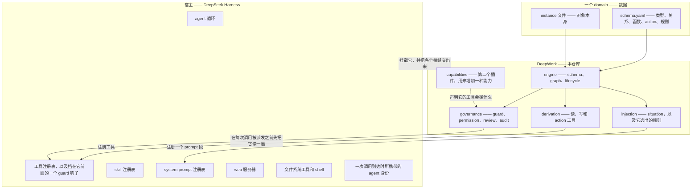
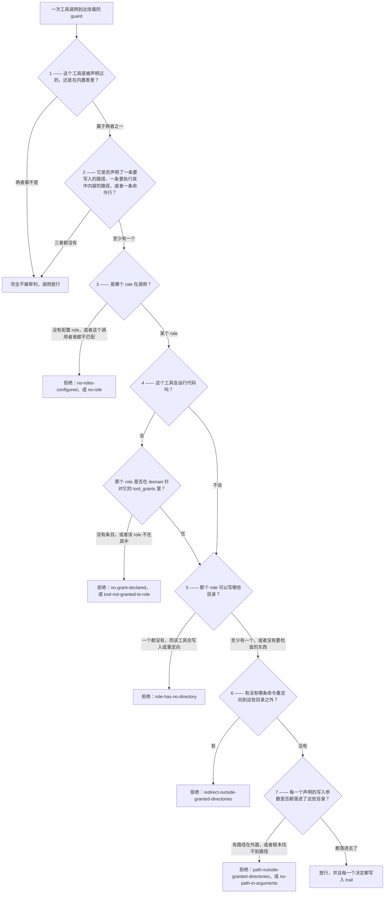
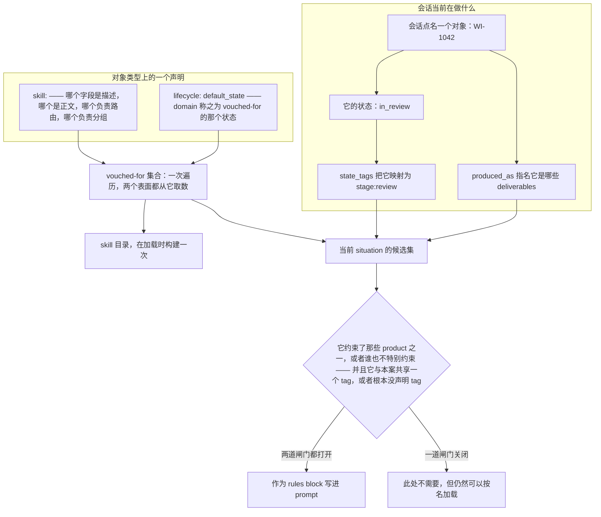
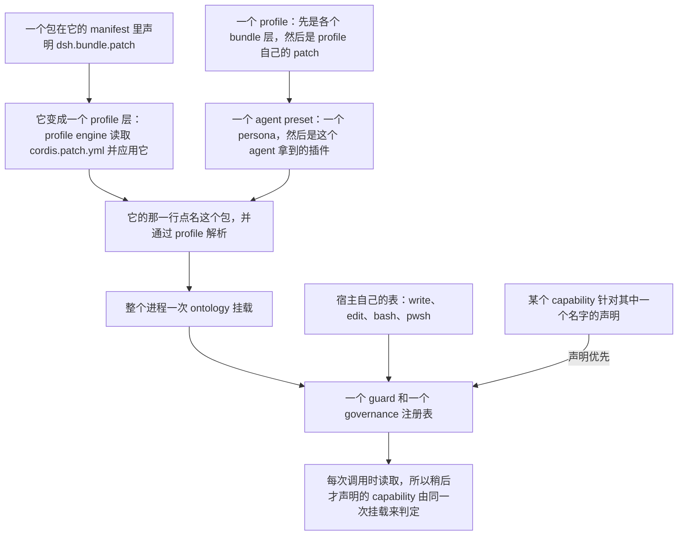

# 架构

[docs/architecture.md](architecture.md) 是本文的英文原文 —— 同一份文档的英文版，供对照阅读。

本文讲的是 DeepWork 由什么构成，以及一次写入在它中间走过的路径。它是写给"配合代码来读"的：下面每一条论断，都是本仓库里真实存在的某个声明、某个分支或某条注释，而且都写明了名字，方便你把它找出来。

本文旁边没有一张"层次图"。这是有意的，而且有来历：原来那张是**退役**的，不是没画。它被画出来的时候，prompt 注入通道还不存在，products 和 deliverables 还没有变成对象，治理还是硬编码的工具名清单而没变成声明，capability 层也还没有——于是每一次改动都把它变成了一张"代码已经不走那条路"的图，而仓库里没有任何东西能提醒你它过期了。`docs/` 里另一张 `derivation.svg` 性质不同：它是真实的一次 `npm run demo`，由 `packages/ontology/scripts/render-demo-svg.ts` 渲染成图，所以它是**重新生成**的，不是重画的。下文不依赖任何一张图。

## 三个层次

宿主拥有 agent 赖以运转的机器：那个循环、各个注册表、guard 钩子、它自带的文件系统工具和 shell、web 服务器，以及一次调用到达时所携带的身份。DeepWork 拥有企业的世界，以及在这个世界里行动的规则。domain 只拥有事实——它就是数据——DeepWork 与 domain 的边界在于：domain 的作者写 YAML，而 engine 里没有任何一行代码是冲着某个具体 domain 写的。

宿主这条边界是一个构建期的断言，代码在一个地方把它讲明了：`register.ts` 声明本包不依赖 DSH 的任何东西，并且用它实际用到的最小结构接口来描述运行时。`index.ts` 里的 `OntologyContext` 对接缝也遵循同一条规则——`inject` 接收插件想要的服务名，返回一个有作用域的 context，因为这里并不 import 宿主自己的服务类型。代价是失去了对 DSH 类型的编译期检查，而代码也给出了接受这个代价的理由：`@deepseek-ai/dsh-tools` 发布得并不可靠，那些类型本来也 import 不进来；而启动时的冒烟测试才是真正的检查——它检查得更多，因为它证明了宿主确实接收这些 schema。

每一条接缝都是可选的，而每一条可选的接缝在缺失时都会被报告出来，而不是被当成理所当然。没有 prompt 注册表的 profile 照样拿得到工具；没有 skill 注册表的照样拿得到 domain；没有 `provide` 的拿不到治理通道，插件会在启动时把这一点说出来。整个包就是这个形状：engine 在完全没有 runtime 的情况下也能工作，所以测试套件跑完不到一秒，也不需要 API key 就能看着一个 domain 推导出它自己的工具。

domain 之所以是数据，是因为 engine 从文件里读出它的名字。全部约定就是短短一列：`primary_key`（回退到 `required_fields` 的第一项，再回退到文件名）、`file_location` 以及它指名的目录、当某个具名对象必须解析成它实际对应的 products 时要用的 `produced_as`，还有承载策略的那些声明——`written_by`、`increment_by`、`tool_grants`、`situation`、`skill`。这条性质由一个测试钉住，而不是靠断言：`engine/graph.test.ts` 把一个毫不相关的 domain 原封不动地交给同一个 engine 加载。

## 一次写入的全程

一次工具调用会在两个地方遇到治理，而这两处回答的是不同的问题。guard 是门：它在任何工具运行之前，先决定这次调用到底能不能碰这个路径。写路径是柜台：它决定这份内容能不能由这个调用者、在这个状态下被写下去。capability 的工具止步于门口。本插件自己的写工具则未经审判地穿过门，到柜台才被裁定——挂载的 guard 从没听说过 `ontology_write`，因为没有东西声明它，它也不在内置表里，所以它的权限住在工具内部。

### 门

guard 由 `index.ts` 里的 `apply` 全局挂载一次，而且即使没有配置任何 role 也会被挂载——一个 role 都没有时，每一次写入都会被拒绝，这也正是"未配置的部署就是只读的部署"唯一可能的意思。身份是从宿主的 `agent.id` 显式映射到 guard 推理所用的那个扁平 `agentId` 的；注释记下了原因，值得重复一遍：把 guard 原样传过去能编译通过，但根本读不到身份，于是每一次写入都因为错误的原因被拒绝。

它只依据两个声明做判断，别的什么都不看：工具自己说它会碰什么，以及 domain 说谁可以在哪里写。

顺序本身就是重点，而每一步待在那个位置都有明确的理由。

身份排在所有判断之前，因为一个没有 role 的调用者手里根本没有可写目录可供推理，而替一个身份不明的调用者猜一个出来，正是策略变成摆设的方式。没有 role 的两种情况被有意分开：`no-roles-configured` 是关于这个部署的事实，`no-role` 是关于这个调用者的事实，而其中一种是配置任务。

会运行代码的工具只凭它的 grant 来判定，而且在查任何目录之前就判定，因为它运行的东西完全不必位于 domain 之内——把 domain 的目录规则借过来，会拒绝掉"在项目里跑这个项目的测试"这种再普通不过的情形。所以 grant 就是它权限的全部，而 domain 什么都不说意味着拒绝而不是许可：对一个执行类工具来说，"没人说过谁可以调用它"是更糟糕的那个答案。

一个 role 可写的目录，是从每一个对象类型上的 `written_by` 和 `file_location` 推导出来的，从不手工罗列，所以收紧一个 domain 就会同时收紧 guard，不需要第二处改动。某个 role 被一些类型点了名，但没有任何类型给它一个目录，那它就贡献不了任何东西，而这个缺口会以 `role-has-no-directory` 的形式显现出来，而不是悄悄把授权放宽。

每一个声明的写入参数都会被看一遍，而不是只看找到的第一个，因为一个点名了两条路径的工具，绝不能因为碰巧落进授权里的那一条而被放行。而路径根本找不到的写工具会被拒绝：本实现移植自的那个实现允许这种情况，这意味着改一下参数名就能悄无声息地废掉 guard。

每一个分支都按失败即拒绝处理，每一个决定都会到达 trail，放行也不例外——条目带着 `kind: 'guard'`，与写路径的条目分开保存，因为在门口就被拦下的调用没有声明的对象类型，若把它当作一次字段为空的写入来记录，日志就会对二者的差别保持沉默。有两个拒绝码是必须叫得出名字的：`no-roles-configured` 和 `no-grant-declared`。两者的意思都是没人说过谁可以写它，而两者都不是 bug。

guard 不覆盖的范围，就写在代码所在的地方，即 `UNCOVERED_BY_GUARD` 里：一条靠自身逻辑而不是靠重定向来写入的 shell 命令，以及一个在工具流水线之外启动的进程。把缺口点出来，是"一条边界"与"对边界的一种信念"之间的区别。

### 柜台

`tools/write.ts` 里的 `writeEntity` 是唯一的写路径。通用的 `ontology_write` 工具走它，每一个声明的 action 都是它外面的一层薄壳——正因如此，权限、lifecycle、独立复核、计数器、必填字段、值域、provenance 和审计都会作用于一个 action，而不必再重复声明一遍。第二条写路径就会是第二处可能漏掉治理的地方，而本实现移植自的那个参考实现恰好犯了这个错误：一次计数器自增直接写文件，绕过了它自己的 ACL。

这些问题按下面的顺序依次提问。

| # | 问题 | 失败时的拒绝 | 为什么在这里 |
|---|---|---|---|
| 1 | 目标是不是一个声明过的类型？ | 抛出一个错误，并点名已声明的类型 | 写路径不能凭空造出一个类型，而工具的 `type` 参数是一个由 schema 生成的封闭枚举。 |
| 2 | 世界的状态是否与这次调用的假设相符？（`create` 的对象必须还不存在，`update` 的必须已存在） | `already-exists`, `not-found` | "这东西存不存在"是关于世界的问题，而不是关于调用者的问题，所以它在权限之前就被裁定。 |
| 3 | 计数器的增量形式正确吗、被声明为计数器了吗、被授予这个调用者了吗？ | `invalid-increment`, `not-a-counter`, `increment-not-permitted` | 谁可以记录"知识被用过了"，和谁可以撰写这条知识，并不是同一件事，所以这项权利来自字段的 `increment_by`。 |
| 4 | 这个 id 能用作文件名吗，以及这个 role 能不能在这里写这个类型？ | `unsafe-id`, `no-caller`, `no-role`, `type-not-writable`, `role-not-permitted`, `path-outside-declared-directory` | id 来自模型，并且会成为路径的一部分，所以它在任何东西被解析之前就被检查；其余部分则由该类型自己的 `written_by` 和 `file_location` 决定。 |
| 5 | 某个声明的 action 是否进一步收窄了这项授权？ | `role-not-permitted` | 一个 action 可以比它写入的类型更窄，而不被执行的收窄就是装饰。它只能收窄，永远不能放宽。 |
| 6 | 这个 id 上是否有一个 domain 没有加载的文件？ | `unreadable-instance` | 否则，一个不可读的文件会被报告成一次缺少字段的 create，而"缺字段"恰恰是它唯一没有毛病的地方。 |
| 7 | 如果这次写入带着 lifecycle 字段：那是不是一个声明过的 transition，以及这个 role 能不能做这次迁移？ | `unknown-state`, `no-declared-transition`, `transition-not-permitted` | 状态的改变是对该对象所处地位的一种主张，而 schema 规定了谁可以做、以及从哪里出发。 |
| 8 | 如果这次 transition 需要一份 verdict：是否存在一份，而且是别人给的？ | `review-required`, `self-review-not-allowed`, `review-producer-unknown` | 独立性不是调用者自己能主张的东西，所以它在需要它的那次 transition 之后被检查，并且是拿一份调用者写不了的记录来核对。 |
| 9 | 该类型的必填字段在合并后的实体上是否都在？ | `missing-required-field` | 判断依据是合并结果，而不是这次调用，因为一次省略了某个字段的 update 会保留磁盘上的原值。 |
| 10 | 这次调用提供的每一个值，是否都在它所属字段声明的集合里？ | `value-not-declared` | 判断依据是这次调用提供的内容，而不是合并后的实体，这样磁盘上已有的错误值就不会拿捏住后续的每一次修正。 |

然后文件被写入、provenance 被追加、graph 原地刷新。这三者的顺序同样不是装饰：provenance 在刷新之前记录，好让同一进程内的一次读取能看到它；刷新之所以原地进行，是因为读工具在加载时就闭包捕获了那个 graph 对象——重新加载成一个新的 graph，会让它们继续盯着一份过期的快照。放行的审计条目最后写，它携带的是被写入的字段*名字*，绝不是它们的值，因为一份把 domain 内容复制到第二个文件里的审计记录，会把这份内容可能泄漏的面扩大一倍。

有两个身份是在这里被决定的，而不是被接受的。身份字段取自 `id`，绝不取自 `data`，所以调用者写不出一个文件名与身份不一致的对象。而"这是谁产出的"这个问题，答案来自 `.provenance.jsonl`，一个平台写入、模型永远看不到的 sidecar 文件。一份自己写着自己产出者的 verdict 是表格，不是管控——这就是复核检查要去读 provenance 的原因，也是产出者无法确认的 verdict 会被拒绝的原因："我们说不清是谁复核的"不等于"有人复核过"。

### 纯粹的状态迁移不是内容写入

有两类调用到达问题 4 时，是刻意不问 `written_by` 的。一次除了计数器增量之外什么都没带的调用，是在记录"知识被用过了"，而不是在撰写这条知识。一次除了 lifecycle 字段之外什么都没带的调用，是对一条记录所处地位的主张，而不是对它内容的所有权——schema 早就把这两者分开了，一个在 `written_by`，一个在 transition 的 `by` 里；对一次纯粹的迁移同时问这两个问题，就是把它们混为一谈。

让这一点变得关键的例证，是 `examples/agreed-practice/schema.yaml` 里的 `send_back`：它由 `reviewer` 执行，而这个 role 在那个 domain 的任何 `written_by` 里都不出现。如果一次纯粹的迁移按内容来授权，那个 transition 就会是"已声明、合法、但永远走不通"——而这正是这个项目存在的意义：抓住这种失败。`examples.test.ts` 在同一个 domain 上把两个方向都钉住了：reviewer 可以把工作打回，但一个字都不能改写；作者则反过来。一次同时带着 lifecycle 字段*和*别的东西的写入，就是内容写入，确实需要 `written_by`；而一次把 lifecycle 字段设成它当前已经是的那个状态的写入，根本不是 transition——它会被报告为 `change: false`，而不是被记成一次从未发生过的晋升。

## 一个声明，两个表面

一个类型声明它的哪些字段承载着值得交给 agent 的经验，而同一份声明会供给两个表面，这两个表面承诺的东西并不相同。

这个集合来自唯一一次遍历 `vouchedInstances`，两个表面都读它，理由很明确：用同一套标准再写一次遍历，今天会得出相同结果，但标准第一次变动时就会分道扬镳。决定成员资格的是 lifecycle 的 `default_state`——也就是 domain 称之为 vouched-for 的那个状态——所以"给读者看的东西"和"agent 可以加载的东西"是同一个答案被问了两次。一个声明了 `skill:` 却没有 `default_state` 的类型会被拒绝，而不是默认把每个实例都算进去，因为一个没说清哪个状态才算 vouched-for 的 domain，等于没有回答这个问题。`examples/agreed-practice` 就是示范：六条 practice 是 `verified`，三条是 `candidate`，这三条不在任何一个表面上，也不计入那六条之中。

**catalogue** 是 know-how。它在加载时通过宿主的 skill 注册表注册一次，每个条目由类型名和 id 命名（`Practice-PRA-003` 变成 `practice-pra-003`），因为没有任何东西能保证 id 跨类型唯一，而一次无声的碰撞就意味着：别人的数据一到，某个 skill 就此不存在了。它能承诺的是：它提供的名字，就是 domain 担保过、并且一次读取会返回的那些名字。它不能承诺的是模型会去查它：路由始终在模型手里，而 skill 只是建议——guard 照旧拒绝它原来拒绝的那些写入，一条"跑一遍回归"的指令，也活不过一个不允许跑回归的 role。

**rules block** 不是 know-how。一条模型可以加载的规则，就是一条模型可以错过的规则，而"金额按整数比较"不是建议，所以同一个集合还有第二个表面：一个 prompt 段，注册为 `deepwork:experience`，渲染在 `<patterns>` 分隔符里面，好让一段 role prompt 能按名字引用这个 block，而不必去引一个本仓库随时可能改写的英文标题。它的位置不是选出来的，而是从宿主自己的 persona 段（`DEPLOYMENT_PERSONA_PREFIX`）推导出来的：身份先于义务被读到，义务先于工具被读到。它的文本是一个函数而不是一个字符串，所以每次组装都会重读一遍 domain 把它重建出来；说明这一点的注释就写在代码旁边，理由是：situation 是从状态推导出来的，而状态是这套东西里唯一会在会话进行中发生变化的部分。插值是关掉的——否则一条恰好含有花括号对的规则会把每一轮对话一起拖垮，因为注册表的 `{{variable}}` 引用是严格的，遇到一个未定义的就会抛错。

这个 block 能承诺的是它不会被错过：无论模型想不想看，它都摆在模型面前。它不能承诺的是这些规则会被遵守，因为它终究只是文本。它也不能承诺自己完整：`budget` 以字符数给列出来的规则设了上限，超过这个上限时，被挡在外面的是那些最不具体的规则，而这一段会自己说明这一点，因为在 prompt 内部看，一条因为篇幅不够而没写进去的规则，和一条不适用的规则，是同一种缺席。被挡在规则块外面的那些，仍然以自己的名字留在 catalogue 里——这收窄的是被强加给 agent 的东西，而不是它可以读的东西。

有两种缺失会被报告出来，而不是渲染成一片沉默。一个 vouched-for 的对象，如果它被指名的字段是空的，就暴露不出任何 skill、也产生不了任何一行，原因会以一条 note 的形式说出来；而如果这个 domain 什么都没有担保，那就不会注册任何段，插件会说明原因，否则一个空段和一个无话可说的 domain 看起来会一模一样。

## situation 从何而来

一条规则讲的是一样东西和一个时刻，这两半都是声明出来的，而不是敲进去的。domain 指名承载"我在做什么东西"的那个类型——`situation: { product_type: Deliverable }`——并把对象的状态映射到 tag 上——`state_tags: { WorkItem: { in_review: stage:review } }`。然后会话点名它正在做的那样东西，tag 随之而来。部署手工声明的 tag 会与由名字计算出来的 tag 合并，而不是被它们取代，这正是让 role——唯一一个任何状态都报告不出来的维度——仍然可以用于收窄的原因。

在示例 domain 上，这条链短到可以一步步走完。一个会话声明它正在处理 `WI-1042`。`resolveActive` 找到带有这个 id 的对象，发现是个 `WorkItem`，读它的状态字段（`stage`）得到 `in_review`，再问 domain 这个状态意味着什么：`stage:review`。另外，它还会问那个 work item *是*哪些 product——也就是 `produced_as` 为 `WorkItem` 的那些 `Deliverable` 实例——得到 `DLV-WI-1042` 和 `DLV-WI-1043`，两个都算，因为这是关于这类东西的事实，而不是关于某一个实例的。接着 `selectRules` 从六条 vouched-for 的 practice 出发，施加两道闸门，每一道都因它自己那一侧没有声明而打开。product 这道闸门留下的是：约束了那两个具名 deliverable 之一的 practice，或者谁也没有特别约束的 practice。tag 这道闸门留下的是：与当前 situation 共享任意一个 tag 的 practice，或者一个 tag 都没声明的 practice。六条里活下来三条，而这一段也照实这么说：`3 of the 6 vouched-for rules apply here`。在它上面有一行记录 situation 从何而来——`Situation computed from: WorkItem WI-1042 is in_review, which this domain maps to stage:review`——这一行不是装饰。一个计算出来的 situation 没有别的办法可供检查：手敲的 tag 在 prompt 里看得见，而由状态推导出来的 tag 必须把那个状态一起带出来，否则一个错误的答案和一个正确的答案就无从分辨。换成点名 `WI-1043` 会选出两条规则，而直接点名 deliverable `DLV-WI-1042` 会选出五条，因为此时 tag 那一半是空的，只有 product 那道闸门在起作用。

规则的约束是从 domain 声明的关系上读出来的，而不是从 engine 认得的某个字段名读出来的：一条规则约束的是它指向 `product_type` 的那些链接所指向的 products，无论那条关系叫什么名字。把 `governs` 改名成 `constrains` 对 engine 没有任何代价，而一个根本没有声明 product type 的 domain 也不算错误——product 那道闸门保持打开，state tag 照样工作，因为这两个声明彼此独立。

排序被决定了两次，而且理由不同。排名（ranking）决定的是当预算开始起作用时*谁能进来*：排名就是这条规则被 situation 真正钉住了多少个维度，product 算一个维度，每个 tag 维度各算一个，所以一条为这个 product、这个 role、这个阶段写的规则，排在一条只点名了 role 的规则前面。渲染决定的是*它们被读到的顺序*：先按标题，再按 id，所以同一个 situation 每次渲染出的 prompt 都一样。两者都在 `selectRules` 里，而且在预算真正开始起作用的那天之前，都看不出来。

不自动的部分，和自动的部分一样有价值。模型是不被路由的：这里决定的只是 catalogue 和 block 里有什么，而不是它们会不会被用上。catalogue 在加载时构建，所以在同一进程中被晋升的 experience 要等下一次启动之后才出现——晋升足够罕见，每轮重新注册一百个 skill 得不偿失——而 block 则是每次组装都重算，理由正好相反。一个 product id 直接点名一个 product，不提供任何 tag，因为 product 没有状态，凭空给它编一个阶段，恰恰就是这套机制想要取代的那种人肉猜测。domain 没有映射到任何 tag 的状态就产不出 tag；一个在会话中途变得不可读的 domain 会失去它的规则，并在这一段里说明这一点，而不是把每一轮对话一起拖垮。匹配不到任何规则的 tag，或者没有任何东西响应的 id，都会被报告出来，而不是变成一次空选择，因为从规则集内部看，一个拼写错误和一次真正的沉默长得一模一样，而其中只有一个是错误。而一个没有声明 situation 的部署，会拿到全部 vouched-for 规则而不是一条都没有：需求这种东西，最不该因为一次意外而遭到筛选。

## capability 层

capability 是给 agent 一种能力的插件，与之相对的是描述世界的插件。本仓库里有三个包是 capability：`test-runner` 跑一个项目的测试并读取这次运行说了什么，`lsp` 从语言服务器回答"这东西定义在哪"，`session-query` 回答"这次会话周围有什么"。每一个都是一项能力，它注册的那些工具是同一件事的两半，而不是一个功能一个工具。（`packages/probe` 是一个插件，但不是 capability：它注册一个工具只为证明插件这条路走得通，并没有给 agent 任何能力。）

capability 必须声明的是它的工具会碰什么，通过 ontology 插件发布的那个通道：一个双方都以裸字符串写出的服务名 `deepworkGovernance`，因为关键正在于这两个包互不 import——一个 capability 可以在完全没有 governance 插件的情况下被挂载，而插件也可以在没有 capability 的情况下加载。可以声明三组参数列表，它们的判定方式各不相同：`writes` 指名存放"工具要写入的路径"的参数，`commands` 指名存放一条命令行的参数，`executes` 指名存放"工具会执行其中任何内容"的路径的参数。`test-runner` 为 `run_tests` 声明了 `executes: ['target']`，`lsp` 为 `lsp` 声明了 `executes: ['file_path']`。谁可以调用一个已声明的工具，则来自另一侧：domain 顶层的 `tool_grants`，它和 `written_by` 放在一起，因为这个部署的策略本来就住在那里。

所以对一个 capability 的工具的权限是分裂的，而这种分裂在三个拒绝码里看得见。一个声明了自己、却找不到对应 grant 条目的工具，会被以 `no-grant-declared` 拒绝。一个 grant 里没有点名调用者 role 的工具，会被以 `tool-not-granted-to-role` 拒绝，而那条消息会列出确实被点名的 role。一个写下 `tool_grants: { run_tests: [] }` 的 domain，是做了一个决定而不是漏了一件事——谁都不能调用它——guard 把这种情况和"沉默"读成两回事，这很重要，否则两者会是同一种缺席。

老实的部分在于 guard 知道什么、不知道什么。capability 是通过语言自身的 API 触达世界的——`node:fs`、一个 spawn 出来的进程、宿主的 session-query 语料——而不是通过一个会终结这些调用的宿主接缝，所以宿主自己的沙箱从来看不到这次调用。guard 对某个工具的认知，就是那个工具对自己所做的声明，而没有任何东西会拿这份声明去核对工具实际做了什么。一个什么都没声明的工具完全不受治理，而平台分辨不出"什么都没声明是因为它什么都不碰"和"什么都没声明是因为有人忘了"。`session-query` 就是现成的例子：它注册了 `session_trace`，这是一次读取，而且它从不调用 `declareTool`——所以 guard 从没听说过它，直接放行。这和那个工具本身并不矛盾，但它仍然是这个缺口的形状。

有两件事让这个缺口不至于隐于无形。声明通道是每次调用时读取的，而不是在启动时快照下来的，所以一个在 ontology 之后加载的 capability 会在同一次启动中就被纳入判定——前提是它声明了。而在宿主提供 info 日志的地方，启动那一行会按名字说出到目前为止声明了多少个工具、domain 又授权了多少个，所以这个数字是读者可以拿来和自己看到的工具做对照的事实。通道本身的缺失也会被报告：一个没有 `provide` 的宿主拿到的插件会说，capability 无法声明它们碰什么，只有这个插件里列出的工具受治理。

一个 capability 的手册，走的是一条 domain 规则所走的同一条路。工具描述说的是这个工具做什么；它没有地方安放做事的先后顺序，也没有地方安放"某个结果并不代表什么"。这些属于 skill，而 `test-runner` 通过 domain 的 vouched-for 规则所用的同一个注册表贡献了一条——于是关于某个工具的 know-how 和关于某项业务的 know-how，通过同一条路径到达 agent，而一个 capability 也不需要改动它旁边部署的那个 domain。它的手册是源码里的一个字符串，而不是旁边的一个文件；这个决定有一个值得记下来的理由：本包发布的是 `lib/**/*.js`，所以一个 markdown 文件在仓库里能用，但在每一次安装里都会不见。

## 组合

插件不会自己挂载自己。一个包在它的 manifest 里声明 `dsh.bundle.patch`，正是这一点把它从一个无用的依赖变成一个 profile 层：profile engine 读取 `cordis.patch.yml` 并在它之前的那些 bundle 之后应用它，宿主的插件管理器会安装并管理这个包，而不是拒绝它。那个文件里的每一行都用裸名字点名这个包，绝不用相对路径——相对路径会相对于文件本身解析，落在包内部，和安装之后的目录结构对不上。

patch 也是配置的来源，而且配置由环境驱动，不是硬编码：`DEEPWORK_ONTOLOGY_ROOT` 挑选 domain，`DEEPWORK_ONTOLOGY_ROLES` 是那道把关写入的 role 映射，而 role 的缺失正是写工具完全不进注册表的原因。这个文件自己的注释里带着一个来之不易的细节——每个 `!!js` 表达式都是单行上的一个整体带引号标量，因为 YAML 会把含有 ` : ` 的裸标量读成一个映射，于是一行配置可能到达时已经不是那个设置了，而且失败得悄无声息。

persona 属于 preset，不属于 ontology，代码在声明某个 mode 的 prompt 的地方就是这么说的："You are the testing agent and this is your job" 是一句关于某一个 agent 的话，而 **domain 描述的是企业，不是 agent**。组合是唯一能说这句话的地方。因此，一个 mode 声明的 role 是作为它自己的段被挂载的，而不是挂进 persona 注册表，理由正是这段代码记下的注册表自身的规则：*同一个层里*重名会抛错，而一行部署 persona 和一段 role prompt 都会去写 agent 的身份。用一个不同的名字绕开了这个问题，同时也说清了这个 block 是什么——这段 prompt 讲的是*这个 mode 下的这个 role*，它出现在那个 role 必须遵守的规则旁边，而不是取代部署自己的 persona。它的位置比 persona 高一位，所以身份先于义务被读到。

有两个长得几乎一样的字段，出于安全理由被分开了。`roles` 为写路径回答"这个调用者是谁"；它必须按失败即拒绝处理，而且它是一个安全决策。`role` 则是关于一个 mode 如何被组合的事实：它选出挂载哪一段 prompt，并以 `role:` tag 的形式加入 situation，所以一个 mode 只说一次它的 agent 是谁，而它们必须遵守的规则和它们工作所依据的 prompt 都听命于它。两者都想要的部署就把两者都写上，而把它们混为一谈则意味着：一个 mode 只要点一个 role 的名字，就能给自己授予写权限。

整个进程只需要一次 ontology 挂载，理由在于注册表是怎么被读取的，而不在于它被挂载得有多频繁。governance 注册表只创建一次，它的 grants 从 schema 里设置一次，而 `govern()` 是每次调用时被咨询的——所以在同一进程里、在 ontology 之后加载的 capability，由同一次挂载来判定，它唯一要做的事就是声明自己。guard 只挂载一次，并看到每一次调用。domain 在每次组装时都会被重新读一遍，所以一次挂载也能跟上世界的变动；而一次写入所回填的那个 graph，被进程里每一个读工具共享。第二次挂载不会增加权限——它只会增加第二套可能与第一套相左的策略，而这正是这个项目存在的意义所在：避免这种局面。

一个注册遮蔽另一个注册的情形，在这里能看到一个小例子。guard 查一个工具时，先查 capability 的声明，再查宿主的内置表，所以拥有某个工具名的包会压过内置表里针对它的条目，而条目会记下它来自两者中的哪一个（`source: 'declared'` 或 `'built-in'`）。撤回遵循同样的规则：只有仍然在位的那个声明才能撤回自己，所以一个更早的 disposer 拿不走一个更晚的声明的工具。更深的层叠——一个带作用域的注册遮蔽同名的全局注册——是宿主的 loader 契约，而不是本仓库定义的东西，本仓库只是依赖它：prompt 注册表"同一个层内重名会抛错"这条规则，告诉插件一个段名是层内的名字，而插件也据此给自己的段命名。

## 局限

本仓库的习惯是：把局限写在它所在的地方，而不是留给别人去发现。下面这些是本文找到的、已经写下来的局限——大多写在与代码相邻的注释里；而当一条局限是关于 domain 格式而不是关于某个分支时，则写在包自己的 limitations 清单里。上面正文里没有把它们中的任何一条抹平。

| 局限 | 写在哪 |
|---|---|
| guard 读的是重定向，不是 shell 自身的逻辑：`cp`、`mv`、`sed -i` 和各种解释器不用重定向就能写入。 | `UNCOVERED_BY_GUARD`, `govern/guard.ts` |
| 在工具流水线之外启动的进程——一个 hook、一个后台服务——完全不会被看到。 | `UNCOVERED_BY_GUARD`, `govern/guard.ts` |
| 什么都不声明的工具不受治理，而一份声明也无法与工具实际所做的事相互核对。 | `govern/access.ts` |
| 插件自己的工具不由挂载的 guard 判定：没有东西声明 `ontology_write`，它也不在内置表里。它的权限在工具内部。 | `govern/access.ts`, `index.ts` |
| 没有 `provide` 的宿主拿不到声明通道，于是只有这个插件自己的工具受治理。 | `index.ts`，启动时 |
| 没有工具 guard 的宿主不会挂载 guard，经由文件系统工具和 shell 的写入不受检查。 | `index.ts`，启动时 |
| 一次写入点名了一个未声明的类型，调用会在到达 trail 之前抛错，所以这次尝试不会被审计。 | `tools/write.ts` |
| 写入不是事务性的：instance 文件被原地重写，没有回滚，也没有并发写保护。 | `tools/write.ts`, `engine/graph.ts` |
| graph 的新鲜度只到上一次加载或写入为止，所以被另一个进程改过的 domain 要到下一次才会被读到。 | `refreshGraph`, `engine/graph.ts` |
| 遍历只走一条关系。一个多跳的问题要分几次调用。 | `tools/derive.ts` |
| 结果被截断时上限是 `maxResults`（默认 50），并且每个值渲染到 120 个字符；两者都会被报告出来而不是悄无声息，但两者都不是无限的。 | `tools/derive.ts` |
| 悬空链接只报告前 20 条，之后归并成一个计数。 | `DANGLING_LINK_REPORT_LIMIT`, `engine/graph.ts` |
| 重复的 id 解析为排序后的第一个文件，后面的被忽略。 | `loadGraph`, `engine/graph.ts` |
| 不可读的 schema 会抛错，所以一个被指到错误目录的插件会启动失败，而不是带着零个工具健康地起来。 | `apply`, `index.ts` |
| 两个 skill 名可能相撞：一个完全不含字母数字的 id 会塌缩成它的类型名，而注册表只保留一个。 | `toSkillName`, `skills.ts` |
| 会话期间被晋升的 experience 要到下一次启动才能加载，因为 catalogue 是在加载时构建的。 | `index.ts` |
| 路由始终在模型手里。catalogue 和 block 里有什么由这里决定；它们会不会被使用则不然。 | `skills.ts` |
| 规则是建议。skill 长不出手来，而 guard 照旧拒绝它原来拒绝的那些写入。 | `skills.ts` |
| rules block 是文本，当预算开始起作用时，它把最不具体的规则挡在外面。被挡在外面的那些仍然可以按名加载。 | `inject.ts`, `index.ts` |
| `budget` 度量的是列出来的那些规则，不包括它们外围的框架文字；而 `0` 按字面理解是"不注入任何规则"，不是"没有上限"。 | `inject.ts`, `cordis.patch.yml` |
| product 没有状态，所以点名一个 product 不提供任何 situation tag；domain 没有映射到的状态产不出 tag；没有 `product_type` 的 domain 会让 product 那道闸门保持打开。 | `inject.ts` |
| 从状态推导出来的 situation，其质量只取决于那个状态字段，而该字段为空时会回退到 lifecycle 的 `initial`。 | `stateOf`, `inject.ts` |
| role 解析是基于前缀的，所以一个按 id 形态定义的 role 映射会继承宿主的命名；前缀 `*` 是直接声明 role，而不是推断它。 | `govern/permission.ts` |
| domain 格式是本仓库自己的。它不是标准，也没有迁移工具。 | `packages/ontology/README.md` |

## 本文涉及的文件

| 路径 | 它是什么 |
|---|---|
| `packages/ontology/src/index.ts` | 插件：它挂载什么、按什么顺序挂载，以及某条接缝缺失时它会怎么做 |
| `packages/ontology/src/inject.ts` | situation、选择过程，以及渲染出来的 block |
| `packages/ontology/src/skills.ts` | 同一个声明的另一半：catalogue，以及两个表面共用的 vouched-for 遍历 |
| `packages/ontology/src/engine/schema.ts` | domain 可以声明什么，以及什么只是警告而不是失败 |
| `packages/ontology/src/engine/graph.ts` | 实例、推导出的边、那两个索引，以及原地刷新 |
| `packages/ontology/src/engine/lifecycle.ts` | 状态、transition，以及某次 transition 的复核要求 |
| `packages/ontology/src/engine/provenance.ts` | 每个对象由谁产出，由平台记录 |
| `packages/ontology/src/govern/guard.ts` | 门：每一次调用，依据声明来判定 |
| `packages/ontology/src/govern/access.ts` | 声明通道，以及宿主自有工具的内置表 |
| `packages/ontology/src/govern/permission.ts` | 谁可以写什么，以及调用者如何解析到一个 role |
| `packages/ontology/src/govern/lifecycle.ts` | 某一次迁移是否可以发生 |
| `packages/ontology/src/govern/review.ts` | 是否存在一份独立的 verdict |
| `packages/ontology/src/govern/audit.ts` | trail，以及为什么字段值从不写进去 |
| `packages/ontology/src/tools/derive.ts` | 读的那个表面，从 schema 推导而来 |
| `packages/ontology/src/tools/write.ts` | 唯一的写路径 |
| `packages/ontology/src/tools/actions.ts` | 声明的 action，作为那条路径外面的薄壳推导出来 |
| `packages/ontology/src/tools/register.ts` | 通往宿主注册表的桥，以及"零依赖"规则 |
| `packages/ontology/examples/agreed-practice` | 用来演练 situation 和纯粹状态迁移的那个 domain |
| `packages/test-runner`, `packages/lsp`, `packages/session-query` | 三个 capability：两个声明了它们碰什么，一个是什么都不声明的读取 |
| `packages/role` | 一个 mode 的 role 以及它工作所依据的 prompt——不是 capability，也不注册任何工具 |
| `packages/ontology/cordis.patch.yml` | 某个 bundle 的组合层；这里的每个包旁边都带一个 |

关于声明和治理模型的完整细节，见 [`packages/ontology/README.md`](../packages/ontology/README.md)。
